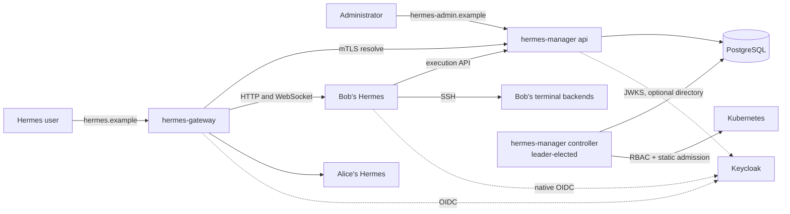

# Personal Hermes architecture

How the manager, the controller and the gateway are built. The
[specification](SPEC.md) defines what they must do (requirements
R1–R19 and the acceptance matrix); the [implementation status](personal-hermes/implementation.md)
lists the evidence. Operator and administrator guides: [instances](personal-hermes/instances.md),
[terminal backends](personal-hermes/terminal-backends.md) and the [dashboard](personal-hermes/dashboard.md).

## Principles

1. **One way to do each thing.** There is one mutation path, one controller
   loop shape, one mechanism per non-repeatable effect and one error model.
   Every safety argument has exactly one implementation.
2. **Decide purely, act separately.** Authorization, state transitions,
   validation and reconciliation planning are pure functions. I/O happens in
   adapters.
3. **Level-triggered reconciliation.** The controller compares desired state
   with observed state and applies the difference. It never follows a
   remembered script, so a restart needs no recovery log.
4. **The namespace is the ownership boundary.** Static, chart-installed
   admission policies make the controller the only writer inside owned
   namespaces. Ownership follows from that and from a recorded namespace UID.
5. **Least authority, including at build time.** Crate dependencies mirror
   runtime privilege.
6. **Boring code.** Short modules named after specification concepts, typed
   states, and no generic machinery beyond what these principles need.

## Components



| Component | Responsibility | Holds | Never holds |
| --- | --- | --- | --- |
| `hermes-manager api` (one or more replicas) | Administration API and dashboard, route resolution, execution API | Database URL for the registry and admin sessions, admin OIDC client, TLS keys, admin-secret *public* sealing key | Kubernetes credentials, secret decryption keys |
| `hermes-manager controller` (one active, Kubernetes `Lease` leader election) | Reconciles instances and terminal environments, expires leases, enforces drains, reports orphans | Database URL, constrained ServiceAccount, material and admin-secret decryption keys | OIDC clients |
| `hermes-gateway` (one or more replicas) | Public login, platform sessions, route resolution, proxying, connection revocation | Gateway OIDC client, session keys, a database role limited to the `gateway_sessions` schema, mTLS client certificate | Registry tables, Kubernetes credentials |
| Personal Hermes | Native agent, dashboard, cron; owner-pinned native OIDC | Private home, its volumes, native keys, execution credential, SSH client key, referenced admin secrets | Kubernetes token |
| Terminal backend Pod | SSH shell and file access | Mounted volumes, authorized key, host key | Kubernetes token; any manager or database access |

One image contains both binaries:

- `hermes-manager`, with the subcommands:
  - `api`
  - `controller`
  - `migrate`
  - `check`
  - `initialize`
  - `grant-administrator`
  - `rebind-cluster`
  - `generate-sealing-key` (writes the controller's X25519 key pair)
- `hermes-gateway`.

The chart deploys `api`, `controller` and `gateway`. It also installs the
controller's RBAC and the static admission policies, with their parameters
taken from the installation values.

## Domain model

### Aggregates

| Aggregate | Fields | Invariants |
| --- | --- | --- |
| `Identity` | `issuer`, `subject`, label cache | Exact validated strings; email is never a key |
| `AdministratorGrant` | identity, `can_manage_administrators`, active | The last active grant that can manage administrators cannot be removed or demoted; targets need verified login evidence |
| `Assignment` | identity, `access`, `template: (id, version)`, `volumes`, `backends: {default, allowed versions, lifetime mode}`, `admin_config` overrides, secret references, `version`, `execution_generation` | One per identity. Each change increments `version` and the instance's `desired_generation`. Changes to volumes or backends also increment `execution_generation`. Saving validates mount compatibility (see [Storage](#storage)) |
| `Instance` | random `id`, assignment, derived `namespace`, `namespace_uid`, `desired_generation`, status | `namespace_uid` is set once, on first observation, and never changes; status is written only by the controller |
| `TemplateVersion` | `id`, `version`, `state ∈ {Draft, Published, Withdrawn}`, definition | Published definitions are immutable; Withdrawn versions cannot be newly selected; rollout eligibility (no storage-class change, no shrink) |
| `TerminalBackendVersion` | `id`, `version`, state, definition | Immutable when published; image digest pinned; `managed-ssh-v2`; UID/GID each in 1..=4294967294, chosen by the administrator |
| `Volume` | instance, `name`, `source`, `path` or `size_gib`, `read_only` | Source must be approved; static paths are clean relative paths; volumes within or across assignments may share equal or nested static paths; size never shrinks |
| `AdminSecret` | `name`, `kind ∈ {Env, File, Registry}`, `version`, sealed value | Value is write-only; each write creates a new version |
| `Material` | instance, `purpose`, sealed value | Created once per `(instance, purpose)` |
| Execution credential | the `execution-credential` material and its SHA-256 digest | Authorizes only while the instance's access is `enabled`; suspension and revocation keep it, so re-enabling restores it |
| `Environment` | instance, backend version, `execution_generation`, key (mode, profile home, session or profile), `pod_uid`, `ssh_host`, `state`, `failure` | State machine below; `failure` (`image_unavailable`, `start_failed`, `contract_failed`) is recorded once, as a `Pending` or `Starting` environment drains |
| `Lease` | environment, client, request ID, parent, `expires_at`, `state` | State machine below; database time only |

Storage sources and the data identity are installation configuration, loaded
at startup. They are not database aggregates.

### State machines

Instance phase (computed by the planner, recorded as status):
`Provisioning`, `Ready`, `Stopping`, `Retained` or `Blocked(reason)`. See the
specification for their meanings.

Environment:

```
Pending ──Pod applied──▶ Starting ──Pod ready, SSH verified──▶ Ready
   │                        │                                    │
   └──────────── drain trigger or worker failure ─────────────────┘
                            ▼
                        Draining ──Pod absent (exact UID)──▶ Retired (final)
```

Drain triggers:

- session close (`per_session` mode);
- idle timeout;
- `execution_generation` superseded while no live leases remain;
- access not `enabled`;
- Pod observed lost, replaced or terminating;
- the drain deadline (5 min), which starts when an environment enters `Draining`.

Lease:

```
Active ──release──▶ Released (final)
  └── expires_at ≤ now() ──▶ Expired (final)
```

- `heartbeat` extends a lease only while it is `Active` and unexpired.
- An acquire that repeats a known request ID returns the original lease.
- A parent join requires an `Active`, unexpired parent with the same client
  and the same environment generation.

Every state is a Rust enum. PostgreSQL stores it as text with a `CHECK`
constraint listing the same values, and guard triggers refuse transitions the
domain does not allow. Transition functions return the new state or a typed
rejection.

## Mechanisms

### Command envelope

Every desired-state write is a `Command`:

```rust
pub trait Command: Serialize + Send {
    type Receipt: Serialize + DeserializeOwned + Send;
    const ACTION: &'static str;
    fn permission(&self) -> Permission;
    fn apply(self, tx: &mut dyn CommandTx) -> Result<Applied<Self::Receipt>, Rejected>;
}
```

`CommandEnvelope::execute(actor, idempotency_key, command)` runs one short
transaction:

1. check the installation;
2. check the actor's current grant;
3. reserve the idempotency key with the body digest; a known key with the
   same body replays its receipt, and with a different body is a conflict;
4. `apply`: load aggregates `FOR UPDATE`, call domain transitions, write;
5. write the audit event;
6. `NOTIFY manager_reconcile`;
7. store the receipt;
8. commit.

The desired state is the work. There is no outbox table. The notification
only wakes the controller sooner.

`grant-administrator` is the only write outside the HTTP API. It runs the
same envelope with an `Operator` actor.

### Controller loop

```rust
loop {
    let instance = queue.next().await;                   // NOTIFY, resync tick or requeue timer
    let desired = store.instance_desired(instance)?;     // one read transaction
    let observed = cluster.observe(&desired).await?;     // bounded reads
    let plan = domain::instances::plan(&desired, &observed);
    materials::ensure(&desired)?;                        // create-once, before any apply
    cluster.apply(&plan.apply).await?;                   // server-side apply, fixed field manager
    cluster.delete(&plan.delete).await?;                 // UID + resourceVersion preconditions
    store.record_status(instance, desired.generation, &plan.status)?;
    queue.requeue(instance, plan.requeue);
}
```

- **Leadership.** The controller uses a Kubernetes `Lease` (15 s duration,
  10 s renew deadline) and stops writing when renewal fails. On becoming
  leader it increments `controller_epoch`. `record_status` writes only while
  that epoch is current, so a deposed leader cannot overwrite newer status.
- **Concurrency.** A bounded worker pool (default 4) processes at most one
  item per instance at a time. Every Kubernetes call has a deadline shorter
  than the renew deadline.
- **Restart.** The queue is rebuilt from PostgreSQL, followed by a full
  resync. A periodic resync (30 s) catches missed notifications and drift.
- **Terminal environments** use the same loop shape with
  `domain::execution::plan_environment`.
- **Periodic tasks** in the leader's term: lease expiry every 5 s (database
  time) and the orphan scan every 60 s (see
  [Backup and restore boundary](#backup-and-restore-boundary)).

Desired object set per instance, rendered by `hermes-render`:

| Object | Enabled | Suspended or revoked |
| --- | --- | --- |
| Namespace (installation and instance labels) | apply | keep |
| PVC `hermes-home` and PVCs for dynamic volumes | apply | keep |
| PersistentVolume and PVC for each static volume (`local` with node affinity, or `nfs`; `Retain`; `claimRef`) | apply | keep |
| ServiceAccount (no token automount), NetworkPolicies | apply | keep |
| Secrets: materials, referenced admin secrets, registry credentials | apply | keep |
| ConfigMap: managed `config.yaml`, trust bundle | apply | keep |
| Service | apply | keep |
| Deployment (1 replica, Recreate, data identity, private home, template mounts) | apply | scale to 0, then delete after workers are retired |
| Terminal backend Pods | per environment | drained |

Native readiness requires all of:

- the Deployment available at the current generation: its
  `agent-platform.io/desired-generation` annotation is the desired generation,
  its rollout is complete, and exactly one ready Pod belongs to it through the
  owner chain Deployment → current ReplicaSet → Pod;
- a valid HMAC-signed home-initialization receipt, read from that Pod's init
  container termination message;
- a bounded native auth-gate probe through the owned Service.

While no Hermes Pod is ready, the controller reads that Pod's `FailedMount`
events. One blocks the instance with `storage_unavailable` and the storage
condition `mount_failed` (a missing static directory, for example). Everything
stays applied, so the instance starts when the volume can be mounted.

Likewise, when the home initializer refuses a home that carries no proof of being
this owner's (a receipt that does not verify, a receipt for another owner, a home
with data and no receipt or intent), it leaves one of five fixed codes
(`HOME_REFUSALS`) as its termination message and fails. The controller reads
that code from the Pod's init container status, and the instance is blocked with
`invalid_initialization_receipt` and the `nativeInit` condition `home_unproven`.
Hermes does not start, the home is not changed, and everything stays applied, so
the instance starts by itself once the proof is back. Any other initializer
failure is retried and shown as provisioning.

The Pod template carries a digest of every input that needs a restart (the
definition, the volumes and the contents of the Secrets and ConfigMaps it
uses). A change that only affects terminal backends, or a restarted manager,
does not restart Hermes.

On start the controller compares the cluster's identity (the UID of
`kube-system`) with the registry's; a different cluster stops it with
`cluster_changed` until an operator runs `rebind-cluster`.

### Non-repeatable effects

Everything except the following is repeatable server-side apply. Each of
these has exactly one mechanism.

| Effect | If repeated | Mechanism |
| --- | --- | --- |
| Instance material: native session keys, execution credential, SSH client key, worker host key, initialization key | A credential silently replaced | Generate, seal to the controller's own key bound to `(instance, purpose)`, `INSERT … ON CONFLICT DO NOTHING` on `(instance, purpose)`, then use the stored row. Secrets are rendered from stored rows. The credential digest and public keys are written in the same insert |
| Home initialization | User data reseeded | Idempotent init container with a signed receipt on the home volume; the controller verifies and never reseeds |
| Namespace UID binding | A foreign or recreated namespace adopted | Bind the UID on first observation if unset; any other UID afterwards gives `Blocked(NamespaceConflict)`. Admission guarantees only the controller can create namespaces with the prefix |
| Deleting a Deployment or worker Pod | A newer incarnation deleted | Delete with a UID and resourceVersion precondition from this reconcile's observation; record completion only after a later observation shows absence |
| Lease grant | Double grant or revival | One transaction: request row, `Ready` check, access and `execution_generation` recheck, insert; terminal states are final |

No automatic path deletes namespaces, PVCs, PersistentVolumes or host data.

### Terminal execution

The plugin protocol is defined by `contracts/hermes-manager/execution.openapi.yaml`.

`acquire` runs in one API transaction:

1. find the instance by the credential's digest, lock it and require access
   `enabled` (otherwise `401`), then expire its due leases;
2. require the assignment's lifetime mode;
3. replay a known request ID (its lease, or `409 lease_not_live` once that
   lease ended), and refuse a known ID with another body;
4. resolve `runtime_id` among the assignment's allowed backend versions,
   using the default when `runtime_id` is empty;
5. find or create the environment keyed by
   `(instance, backend version, execution_generation, key)`, where the key is
   the session for `per_session` and the profile's home otherwise. A draining
   environment is not reused; the next one is created once it has retired.
   New environments count against the backend's `maxEnvironments`, and one
   that would exceed it is answered `503 dependency_unavailable` and not
   created; creating one wakes the controller;
6. if it is `Ready`, grant a 120-second lease and return the worker's address
   and the instance's worker host key; if it failed, return
   `422 backend_failed`; otherwise return `409 environment_pending` with
   `Retry-After: 1`.

Heartbeats extend a live lease by 120 seconds, never past the backend's
`maxLeaseSeconds` after its creation. Released and expired leases are final.

The controller takes each environment from `Pending` to `Ready` in the same
pass as its instance:

1. apply the worker Pod (`hw-<environment>`) with the backend's image,
   resources and bound slots, the instance's client public key as the only
   authorized key and the instance's host key;
2. record its UID once it is observed;
3. when it is ready, verify SSH in-process with `russh`: authenticate with the
   instance's client key, pin the provisioned host key and check that the
   shell runs as the backend version's declared UID. A different shell UID,
   host-key mismatch or explicit authentication refusal gives `contract_failed`,
   as does a key that is accepted while three fresh logins in a row open no
   session: sshd does that when the image's `worker` user is not the UID the Pod
   runs as.
   This probe checks UID, not GID; the Pod's group and `fsGroup` come from the
   backend record.

A worker that cannot start is never retried with another image. A pull error
(`image_unavailable`), a failed or crash-looping container (`start_failed`), a
refused apply or a failed SSH check (`contract_failed`) moves a `Pending` or
`Starting` environment to `Draining` with the reason recorded once. Acquisitions
for it return `422 backend_failed`, and the administration API shows the reason
on the instance's environments. An unreachable worker or an SSH timeout is not a
failure; the controller keeps checking.

When the assignment's backends or volumes change, `execution_generation`
increments. New acquisitions create environments under the new generation,
and older environments drain when no leases remain. Live leases are untouched
until they end (at most the backend's `maxLeaseSeconds`) or, once the
environment is draining for another reason such as an access change, the drain
deadline (5 minutes) passes. Draining deletes the
observed Pod by UID and resourceVersion; the environment retires once the Pod
is absent. A not-enabled instance stops Hermes only after its workers retired.

Lease expiry runs as a periodic controller task (every 5 seconds) using
database time.

### Storage

Storage sources are defined in Helm values. They are rendered into both the
controller configuration and the admission policy parameters:

```yaml
hermesManager:
  dataIdentity: { uid: 1000, gid: 1000 }
  storageSources:
    - id: nvme
      storageClass: { name: local-nvme }
    - id: host-data
      localPath: { node: server-1, root: /srv/hermes-data }
    - id: nas
      nfs: { server: nas.internal, root: /export/homes }
```

- **Dynamic volumes** (`storageClass`) become PVCs with the requested size.
  The private home is always a dynamic volume from the template's home source.
- **Static volumes** (`localPath`, `nfs`) become one PersistentVolume and one
  PVC per volume. The PV's path is `root/path`, with node affinity for
  `localPath`, reclaim policy `Retain` and a `claimRef` to the PVC in the
  owned namespace. The deployment must create the directory beforehand with
  ownership and permissions suitable for its consuming identities.
- **Static sharing.** Administrators may share equal or nested paths within or
  across assignments with independent read-only settings. Each volume has its
  own PV and PVC in its instance namespace;
  local paths use ReadWriteOnce and node affinity, NFS uses ReadWriteMany.
  Hermes uses the data identity; workers use the backend identity. Containers
  sharing an identity have no per-user permission separation on writable
  shared folders. Different identities follow Unix permissions without mapping
  or warnings; backend-only volumes support another identity. Workloads
  coordinate concurrent writers.
  Operators keep provisioner roots and private instance data outside static
  source roots. Admission confines each PV to an approved root.
- **Mount rendering.**
  - The Hermes container gets `hermes-home` at `/opt/data` and the
    template's volume mounts.
  - Each terminal backend Pod gets its version's slots that the assignment
    binds.
  - A volume mounted in both places must use the same path (checked when the
    assignment is saved).
  - The effective mount is read-only if either side marks it read-only.
  - All Pods run with `runAsUser`/`runAsGroup`/`fsGroup` equal to the data
    identity.
- **Scheduling.** Pods that share a `localPath` or node-local volume land on
  that node because of the PersistentVolume node affinity. A shared volume on
  a multi-node cluster needs NFS or an RWX class.

### Admin settings and secrets

`hermes-render` builds the managed `config.yaml` from three layers:

1. platform-enforced settings;
2. assignment overrides;
3. template `adminConfig`.

Hermes applies that file over the user's configuration. Validation rejects any
attempt to change platform-enforced keys.

Admin secret flow:

1. The API seals each value with the controller's public key (an X25519
   sealed box) and stores only the sealed value. The API can write secrets but
   never read them.
2. The controller unseals the referenced versions and renders them into the
   instance's `admin-secrets` Secret, or a `dockerconfigjson` Secret for
   `registry` secrets.
3. The Deployment exposes them as environment variables or as read-only files
   under `/run/hermes/admin-secrets/`.

Before it starts work, the controller checks that its key opens the stored
material: when at least one row exists and none (of the first eight it tries)
opens, it exits with `sealing_key_mismatch`. A wrong key would otherwise seal
material for new instances that the right key could never open. Existing
instances are left as they are; an installation without material has nothing to
check.

A new secret version, or a change in which secrets are referenced, increments
the desired generation of every referencing instance, so they restart with the
new value.

### Routing

`hermes-gateway` handles every request on the Hermes hostname
(`gateway.openapi.yaml`):

1. Remove hop-by-hop and reserved headers (`Forwarded`, `X-Forwarded-*`,
   `X-Hermes-*` and similar) and the platform cookies from the request. Set
   `Host`, `X-Forwarded-Host` and `X-Forwarded-Proto` itself.
2. Require a valid server-side session. The gateway uses OIDC authorization
   code with S256 PKCE, state and nonce; the session record holds encrypted
   provider tokens, and provider state is refreshed at most every 60 s. A
   valid session may be reused for 5 s per cookie pair.
3. Resolve `(issuer, subject)` via `POST /internal/v1/routes/resolve` over
   mTLS, with a 2 s deadline. A ready decision may be cached for 5 s per
   session; no other decision is cached. The resolver reads the registry on
   every call: a route needs an enabled assignment and a ready instance whose
   observed generation is the desired one.
4. Proxy to `hermes.<namespace>.svc:8080`. That destination is built only
   from the resolver response, and must be exactly the instance's own
   namespace in this installation.
5. Filter `Set-Cookie` so no backend can set the reserved platform cookies.

WebSockets are spliced after the upgrade: the gateway passes bytes unchanged,
so native heartbeats and extensions work, and it requires the exact public
`Origin` on the handshake. WebSockets and streamed responses without a length
are re-checked every 5 s against the session and the resolver. They end when
the session ends, when the decision is no longer the same route (instance,
route generation and authorization version), or after two consecutive failed
checks; the second check follows the first failure after 1 s, so a failure
ends them within 10 s.

`pending` responses become an owner-only status page, `denied` a `403` page and
`unavailable` a `503` page; requests that are not page loads get the same
statuses as JSON. Native callbacks are forwarded only with a valid platform
session that resolves to the same owner.

Platform sessions are sealed in PostgreSQL under the gateway's session keyring.
New sessions use the active key; every key still listed opens the sessions
sealed under it, so a key added as the new active one keeps existing sessions
alive, and removing a key ends exactly the sessions sealed under it. A restart
with the same keyring ends nothing.

Logging out ends the platform session and expires the native cookies. The
gateway intercepts native `POST /auth/logout` (exact `Origin` required): it
forwards the request when the instance is ready, with a 2 s deadline, so
native Hermes can revoke its own tokens, then ends the platform session,
whether or not the instance answered.

The manager trusts the gateway's verified mTLS identity for the asserted
subject. The gateway is in the trust base anyway, because it carries all user
traffic. Native Hermes still independently verifies its owner through its own
OIDC login.

## Security model

### Trust base and threats

The trust base consists of:

- Kubernetes;
- PostgreSQL;
- the manager API and controller;
- the gateway;
- Keycloak.

Browsers, Hermes instances (which run agent code), terminal backends and
network peers are untrusted.

| Threat | Controls |
| --- | --- |
| A user reaches another owner's instance | Gateway routes only by verified identity to a registered namespace; native owner pin; NetworkPolicy admits only the gateway to native ports |
| Forged identity or routing headers | Stripped by the gateway; instances reachable only from the gateway |
| Compromised Hermes instance | No Kubernetes token; execution credential scoped server-side to that instance; NetworkPolicy allows only the execution API, its own workers and approved egress |
| Compromised terminal backend | No credentials beyond its mounts and keys; SSH ingress only from its Hermes and the controller |
| Instance requests another owner's backend, image or mount | Requests carry only `runtime_id`; resolution happens inside the caller's assignment; images and mounts come only from PostgreSQL |
| Administrator assigns a shared folder | Trusted administrators decide who shares each folder; assignment audit records include volume source, path, size and read-only settings |
| Compromised or buggy API | No Kubernetes credentials; cannot read admin secrets or materials; what it writes is bounded by static admission when rendered |
| Buggy controller | Static admission rejects privileged Pods, hostPath, unapproved PersistentVolume paths, foreign namespaces, unpinned images and token automount |
| Compromised controller | Accepted (trusted). The controller writes component labels and could label a Pod as worker to select any non-zero identity. RBAC limits it to the namespace prefix, owned namespaces and PersistentVolume creation, without cluster-wide Secrets or role escalation |
| Compromised gateway | Accepted (trusted). Native owner pin still requires the real owner's native login |
| Stale authorization after revoke | 5 s freshness bound; execution credential revoked in the same transaction |
| Secret leakage | Sealed at rest; write-only API; no values in responses, audit, logs or errors. A delivered admin secret is readable by its owner's agent; give each person their own provider key, or use a model gateway that issues per-person keys, rather than sharing one |
| Admin CSRF or cross-origin attacks | Separate admin hostname; host-only `SameSite` cookies; `Origin` check and CSRF token on mutations |
| A page of a sibling host acting with an owner's cookies | The gateway refuses requests that can change state, and WebSocket upgrades, whose `Origin` is not the public origin; a refused logout expires no cookie |

### Static admission policies

The chart installs these as ValidatingAdmissionPolicies with Deny bindings.
`hermes-render::admission` renders them, together with the controller's RBAC,
from the installation values: the prefix, the approved roots, nodes and
servers, and the data identity are literals in the CEL expressions. The
controller cannot write policies. Golden files pin the output, and the k3s
integration tests install it and act as the controller's real ServiceAccount.

| Policy | Rule |
| --- | --- |
| Namespaces | Only the controller may create them, only with the installation prefix and labels |
| Owned namespaces | Only the controller may write objects. The cluster's own components are allowed: `kube-system` controller ServiceAccounts (ReplicaSets and Pods of owned Deployments, EndpointSlices, PV binding, the garbage collector, the root CA publisher), `system:kube-controller-manager`, `system:kube-scheduler` (claim binding), `system:apiserver` and nodes. Events are exempt. Cluster-scoped objects are out of scope; a `namespaceSelector` alone would match them |
| Controller scope | The controller writes only namespaces, PersistentVolumes, objects inside instance namespaces and its leader Lease |
| Pods | Hermes Pods and Pods with missing or other component labels use the data identity. Worker-labelled Pods use non-zero user/group IDs, with `runAsNonRoot: true`. No container overrides its Pod identity or sets `runAsNonRoot: false`; no privilege escalation; capabilities dropped; no host namespaces or hostPath; volumes limited to PVC, Secret, ConfigMap, emptyDir and projected; digest-pinned images; `automountServiceAccountToken: false` |
| PersistentVolumes | Created only by the controller; type `local` (under an approved root, with node affinity to the approved node) or `nfs` (approved server and root); `Retain`; `claimRef` into an owned namespace |
| RoleBindings | Only the fixed instance role, bound to the controller ServiceAccount |
| Services | ClusterIP only, without external IPs |

Every expression guards optional fields with `has()`: the policies fail
closed, so a missing field would otherwise deny unrelated requests.

## Backup and restore boundary

The deployment backs up PostgreSQL and the storage source roots, for example
to S3. The manager makes restores safe:

- it never adopts unrecorded namespaces or volumes, and reports them as
  orphans instead: every 60 seconds the leader lists the namespaces and
  PersistentVolumes with the installation label, then reads the registry, and
  replaces the epoch-guarded report in `orphans` with the objects that belong
  to no recorded instance (a namespace under another name than its instance's,
  a volume of an unknown instance);
- a changed cluster identity blocks the controller until an operator runs
  `rebind-cluster`;
- static volumes point at the restored paths;
- dynamic volumes depend on a deterministic provisioner path pattern.

`GET /api/v1/orphans` and the dashboard's Storage page show the report with
first- and last-seen times; `rebind-cluster` clears it. There is no
coordinated checkpoint: the manager does not quiesce writers for a backup.

## Code architecture

### Crates

| Crate | Depends on | Contains |
| --- | --- | --- |
| `hermes-core` | `serde`, `thiserror`, `uuid`, `url`, `sha2` | `domain` (aggregates, states, planners, validators, orphan detection; synchronous, no I/O) and `app` (commands, queries, ports, envelope, controller loop); the `testing` feature adds the in-memory store, fakes and the port contract suites |
| `hermes-wire` | `serde`, `hermes-core` | DTOs for every contract, round-trip tested against the OpenAPI schemas |
| `hermes-store` | `sqlx`, `hermes-core` | Repositories, `CommandTx`, read models, migrations, guard triggers, `LISTEN`/`NOTIFY` |
| `hermes-render` | `serde_json`, `hermes-core` | Pure renderers: instance object set, worker Pod, managed configuration, admission policies and RBAC (golden files, also compared by the chart tests) |
| `hermes-kube` | `kube`, `k8s-openapi`, `hermes-render`, `hermes-core` | Cluster port: bounded observation, server-side apply, preconditioned delete, worker failures, owned-object listing, leader election |
| `hermes-identity` | `jsonwebtoken`, `openidconnect`, `reqwest`, `sqlx`, AEAD | Token verification, OIDC flows, sealed session stores in PostgreSQL, Keycloak directory |
| `hermes-native` | `reqwest`, `russh`, `hmac`, `crypto_box` | Sealing and unsealing, init-receipt verification, native auth-gate probe, SSH readiness |
| `hermes-http` | `axum`, `rustls`, `hermes-core`, `hermes-wire`, `hermes-identity` | Administration, resolver and execution routers; TLS listeners with peer identity; error mapping per contract; dashboard assets |
| `hermes-proxy` | `hyper`, `axum`, `reqwest`, `hermes-identity`, `hermes-wire` | Gateway core: header and cookie hygiene, resolver client, caches, forwarding, WebSocket and stream supervision, status pages |
| `hermes-manager` | manager crates | CLI, configuration and the role and operator entry points |
| `hermes-gateway` | `hermes-proxy`, `hermes-identity`, `hermes-http` | Gateway binary and configuration; no registry store, no `kube` |
| `hermes-testkit` | test-only | Fake OIDC realm over TLS, certificates, contract-checking HTTP client |
| `hermes-architecture` | test-only | Dependency-rule and `TESTS.md` traceability tests |

An architecture test enforces this table:

- `hermes-core` imports no I/O crate;
- adapters do not depend on each other (except `kube` on `render`);
- `hermes-gateway` reaches neither `kube` nor the registry store transitively.

Contexts use the same module names in every crate:

- `installation`
- `access`
- `assignments`
- `templates`
- `backends`
- `storage`
- `secrets`
- `instances`
- `execution`
- `routing`

### Errors

| Type | Layer | Notes |
| --- | --- | --- |
| Rejections and `Problems` | domain | Stable snake_case codes, such as `mount_path_mismatch`, `last_administrator`, `storage_migration_required`, `lease_not_live`; validation problems carry a JSON pointer |
| `AppError { kind, code, problems }` | app | `kind` is one of `Invalid`, `Unauthenticated`, `Forbidden`, `NotFound`, `Conflict`, `Precondition`, `Pending`, `Unavailable` |
| `StoreError` | store | `Conflict` (serialization failure, deadlock, unique violation) or `Unavailable`; never SQL text or URLs |
| `ClusterError` | kube | `Rejected` (admission or validation), `Conflict` (a precondition or race lost) or `Unavailable` |

Mappings are exhaustive matches. Each contract maps `(kind, code)` to one HTTP
status and `error` value, and the integration tests check every response
against the contract's schema.

### Schema

| Schema | Tables |
| --- | --- |
| `manager` | `installation`, `controller_epoch`, `identities`, `administrator_grants`, `catalog_versions` (template and terminal backend versions), `assignments`, `assignment_volumes`, `assignment_backends`, `instances`, `admin_secrets`, `materials`, `environments`, `leases`, `acquire_requests`, `orphans`, `orphan_scan`, `command_receipts`, `audit_events` |
| `admin_sessions` | `browsers`, `flows`, `sessions` |
| `gateway_sessions` | `browsers`, `flows`, `sessions` |

Triggers guard only against data corruption:

- immutability of published versions, receipts, audit records and
  `namespace_uid`;
- monotonic generations;
- final lease and environment states.

Each trigger names the domain rule it mirrors.

## Design decisions

| Decision | Reason |
| --- | --- |
| Level-triggered controller with server-side apply | Most Kubernetes writes are repeatable, so a restarted controller needs no recovery log |
| Five named non-repeatable effects, one mechanism each | Only these can do harm when repeated; everything else is plain apply |
| One leader-elected controller; its queue is rebuilt from PostgreSQL | No per-item leases or fencing tokens; the epoch guards every status write |
| The namespace UID is the ownership root, with static admission | Admission makes the controller the only writer in owned namespaces, so no per-object provenance is needed |
| `execution_generation` stamped on environments | A backend or volume change needs no activation protocol: new acquisitions get the new definition, old environments drain |
| The administration API is the only writer of desired state | One path for every change, with one audit log and one idempotency rule |
| One versioned catalog (Draft, Published, Withdrawn) for templates and backends | Published definitions are immutable; rollouts pin exact versions |
| `hermes-gateway` as a Rust reverse proxy | Session, decision, hygiene and the revocation of open connections live in one tested component, instead of an edge proxy, an auth service and an interpreted plugin |
| The gateway asserts identity over mTLS | No user token is relayed; the gateway carries all user traffic and is trusted anyway |
| The native owner pin stays mandatory | Hermes checks its owner independently of the gateway |
| One 5 s freshness bound for HTTP and WebSockets | One bound, one mechanism |
| Storage sources in installation values; volumes per assignment | Administrators choose storage without cluster access; shared volumes keep the same path in Hermes and workers |
| Write-only admin secrets sealed to the controller's key | Enforcing a provider usually needs a key, and the API never needs to read it |
| SSH readiness checked in-process with `russh` | No subprocess in the privileged controller |

## Verification strategy

[TESTING.md](TESTING.md) describes the implemented language-native unit,
dependency integration and Python/pytest E2E layers, and the direct-k3s and
k3d fixture paths. The [coverage assessment](testing/coverage.md) records current
evidence and the [gap register](testing/gaps.md) the remaining work. This
section describes what exists.

Current test implementation:

| Level | Existing runner and proving boundary | Current execution |
| --- | --- | --- |
| Unit | Cargo domain/application fakes, finite planner state-grid and targeted transition tests; pytest Python runtime/plugin/release/privacy units; Vitest UI logic | PRs and main commits; Cargo also runs external-dependency tests in the same workspace invocation |
| Integration | Shared store cases on memory and PostgreSQL; actual HTTP/TLS/OIDC/SSH fixtures; binary abort tests; runtime-image checks; chart/render/golden comparisons; mocked UI browser workflows and the separate production-server CSP case | PR/main jobs; PostgreSQL and selected explicitly ignored/feature-gated tests need their dedicated commands |
| E2E | The standalone native scenario and collected pytest cases install the chart and reach real Hermes through Keycloak and the gateway, with a fake model and private registry; restore uses a second direct-k3s cluster | PR/main Checks runs the sequential script on direct k3s. Manual Cluster scenarios runs the pytest k3d profiles, including real-browser journeys and a separate destructive platform pool |

Existing mechanisms and their limits:

- **Shared store contracts.** One macro instantiates the common application/store
  cases for the in-memory and PostgreSQL stores. Other external ports have
  focused adapter tests; there is not one generic conformance suite for every port.
- **Fault injection.** The test-only feature aborts the API around envelope
  commit and the controller at material/apply/status/delete boundaries. The
  process tests prove those locations; this is not a claim that every worker,
  lease or concurrent leader interleaving is tested. Release builds exclude
  the feature.
- **Traceability.** `services/hermes-manager/TESTS.md` maps requirement,
  acceptance, bound and composite contract-operation rows to named functions.
  Architecture tests enforce row/name consistency. The
  [execution ledger](../tests/verification/README.md) separately requires exact
  Python/Rust collection, reviewed proving levels and passing per-case outcomes
  in dedicated profiles, including shared macros, faults and ignored cases.
  Helpers without collected wrappers are explicitly uncollected gaps. Full
  clause/status/header coverage and TypeScript execution inventories are not
  implemented.
- **Planner coverage.** Finite desired/observed state-grid, targeted transition
  and deterministic command-sequence tests exist. No `proptest`, fuzzing,
  mutation or measured branch-coverage pipeline is configured.
- **Golden files.** Rendered manifests, admission and chart/config fixtures are
  reviewed outputs; supported tests update them only with `UPDATE_GOLDEN=1`.
  Golden agreement complements real authorization and packet-level tests.
- **CI.** `.github/workflows/checks.yml` runs Python/chart/privacy checks,
  dashboard and Rust suites, binary/image/runtime checks, Kubernetes adapter
  and controller-process checks, and the full native system script on PRs and
  pushes to `main`. Python/Rust profiles retain sanitized JSON/JUnit reports.
  No scheduled extended/soak profile exists there.
  The manually dispatched `Cluster scenarios` workflow runs collected k3d
  network, acceptance, browser and destructive cases. Tag publication first
  requires successful latest `Checks` and `Cluster scenarios` runs for the exact
  commit, then performs separate Python/build smoke checks. Matching the tested
  and published artifact digests remains in G20.

The [verification commands](personal-hermes/implementation.md#verification-commands)
are the working commands.
