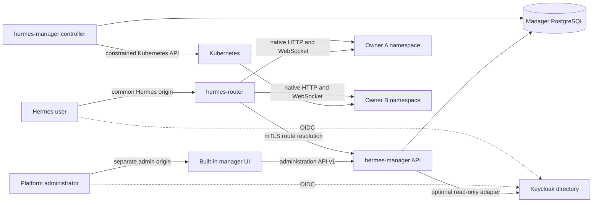
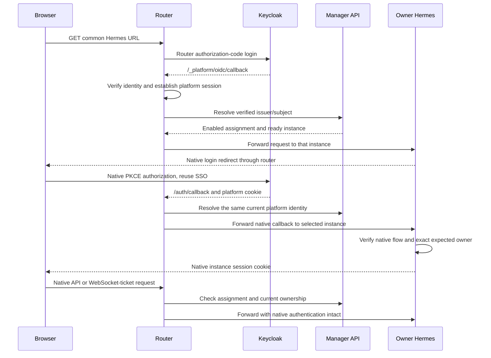

# Personal Hermes architecture

Status: proposed implementation architecture, based on release 0.6.1. None of
the new manager/router services or chart settings below exist in that release.
See the [specification](specification.md) and [delivery plan](plan.md).

## Ownership and sources of truth

Keycloak owns authentication, credentials, stable subjects and identity-provider
roles. The manager owns platform assignments, instance identities, lifecycle and
the registry of resources it commissioned. PostgreSQL is the durable assignment
and registry store. Kubernetes is the observed execution environment.

The authorization decision is the conjunction of a valid identity, any
configured coarse identity-provider eligibility rule, an enabled manager
assignment and a ready instance owned by that exact identity. Authentication or
membership in a Keycloak group does not independently commission an instance.
Email changes do not change ownership. Deleting and recreating an identity with
the same email does not transfer its instance.

Administration initially lives inside `hermes-manager`. Extracting the panel
later must change deployment and presentation only, not these ownership rules.

## Implementation stack

Implement the new manager and OIDC routing adapter in Rust. Use Axum/Tokio for
HTTP and asynchronous services, kube-rs for Kubernetes reconciliation, SQLx for
PostgreSQL and migrations, and the openidconnect crate for OIDC protocol work.
Keep domain types and application interfaces separate from framework adapters.
The manager serves its built-in UI assets and versioned administration API.

The preferred proxy transport is an official, pinned Traefik Proxy image using
multi-layer routing, with a separate Rust ForwardAuth/OIDC adapter. This choice
requires a local compatibility spike, including active WebSocket revocation;
the documented revocation bound remains a release gate. The platform must not
assume the Kubernetes distribution's bundled proxy supports the required version.

[Traefik itself is written in Go](https://github.com/traefik/traefik); Rust is the
language of our manager and external authentication adapter. The adapter is a
separate HTTP service called through built-in ForwardAuth, not a Rust plugin
loaded into Traefik. The parent/child routing hierarchy uses built-in proxy
configuration. An Envoy alternative would likewise need an authentication and
assignment integration, for example its external-authorization API; neither
proxy automatically understands the manager's user-to-instance registry.

Routing is based on verified OIDC identity: `(issuer, subject)` selects the
enabled manager assignment and its registered instance. A routing header is only
an internal representation of that already-authorized result. Neither a browser
header nor an unverified decoded JWT is an identity or routing authority.

## Components



| Component | Responsibility | Credentials and privilege |
| --- | --- | --- |
| Manager API/UI | Administrator login, assignment commands, status, audit and internal route resolution | Manager application database role, admin OIDC client, optional directory reader; no Kubernetes token |
| Manager controller | Reconcile desired instances and coordinated lifecycle operations | Controller database role, constrained namespace bootstrap and instance-scoped Kubernetes bindings |
| Rust router auth adapter | Validate OIDC sessions, resolve the current owner's assignment and supply an authorized routing decision | Router OIDC client, restricted session-store role and manager mTLS client; no Kubernetes token or assignment writes |
| Traefik proxy | Apply parent authentication before selecting a child backend; proxy native HTTP/WebSockets | Restricted ForwardAuth mTLS client and read-only generated routing configuration; no OIDC secrets or Kubernetes token |
| Personal Hermes | Native dashboard, agent state, model onboarding and exact owner authentication | Its own home, native session keys and approved service credentials |
| Personal execution manager | Existing command-execution and lease management for that owner | A distinct client credential and namespaced worker permissions with exact admission policy |
| Deployment/backup integration | Database, storage classes, ingress, identity-provider clients, encryption and external recovery storage | Deployment-owned infrastructure credentials, never distributed to personal instances |

The API/UI and controller are two process roles in one new manager image, run as
separate Deployments. This keeps the initial product together while preventing
the browser-facing process from holding the controller's Kubernetes credential.
The Rust router auth adapter is a second new platform image. Traefik uses its
official image. Together they implement the logical `hermes-router` component;
no separate frontend service is required yet.

## Administration boundary and future panel extraction

Proposed source boundaries:

```text
contracts/hermes-manager/openapi.yaml
services/hermes-manager/
  Cargo.toml                          # Rust workspace
  crates/hermes-domain/src/            # identity, assignments and instance invariants
  crates/hermes-application/src/       # commands, queries and interface traits
  crates/hermes-adapters/src/          # HTTP, PostgreSQL, directory and Kubernetes
  crates/hermes-manager/src/bin/       # API/UI and controller process roles
  crates/hermes-router-auth/src/       # OIDC sessions and ForwardAuth adapter
  ui/                                 # built-in administration presentation
```

These paths describe work to create, not existing packages. Domain code imports
no HTTP, UI, Kubernetes or identity-provider SDK. Application code depends on
ports such as `AssignmentRepository`, `InstanceRepository`, `IdentityDirectory`,
`InstanceDriver`, `OperationQueue`, `AuditSink` and `CheckpointCoordinator`.
Rust traits express these ports; adapters implement them. HTTP endpoints invoke
application commands and queries using a validated actor, never a UI-supplied
administrator flag.

The browser UI calls the versioned administration API. It has no SQL connection,
Kubernetes client or direct directory access. API-only mode disables UI serving
while retaining the same contract and authorization. A later panel uses that API
with an administrator access token targeted at its audience; the manager still
validates the human actor and permissions. A panel service identity alone cannot
impersonate that administrator. API-only contract tests enforce this seam.

Serve administration on a separate origin, for example
`https://hermes-admin.example.org`, from `https://hermes.example.org`. Personal
assistant content must not share the administration session's browser origin.
Use separate OIDC clients, host-only cookies and explicit CSRF checks. Do not
enable broad credentialed CORS to make a later panel work.

The optional directory adapter can search users and confirm canonical subjects
with read-only permissions. Exact issuer/subject entry remains available when
directory access is not configured. It never creates Keycloak users, changes
passwords, grants identity-provider roles or imports a Multica user directory.

## Durable identity and reconciliation

Persist an installation identity, exact issuer/subject identities, assignments,
instances, resource UID bindings, operations, checkpoint epochs and audit events.
The [specification](specification.md#durable-data-contract) defines the records.

An enabled assignment commits desired state and an outbox event in one SQL
transaction. A leased worker reconciles it without holding a SQL transaction
open across Kubernetes calls. Uniqueness constraints, deterministic names,
optimistic versions and operation fencing prevent duplicate instances. Before
publishing readiness or applying a destructive step, recheck desired generation,
lease ownership and observed Kubernetes UIDs.

Resources left by an interrupted attempt are reconciled only when installation,
instance, namespace and UID checks agree. A name or label match alone cannot
authorize adoption. Disable races cannot publish a usable route because route
resolution independently reads the current assignment on every request.

## Instance namespaces and the elevated controller

The first implementation uses one namespace per personal instance, with names
derived from installation and random instance IDs, never from email addresses.
Each namespace contains its Hermes Service/Deployment, retained home and
workspace PVCs, native keys, optional provider credentials, an execution manager
and its constrained worker resources. The manager database stays in the control
plane. A single Kubernetes cluster hosts these namespaces; this adds no VM per
user.

This choice lets Hermes and its execution Pods reference that owner's selected
PVCs without cross-namespace mounts or a globally shared home. For RWO storage,
the approved scheduling policy must co-locate consumers and reject unsupported
multi-node sharing. Storage backends and recovery placement remain deployment
inputs. Namespace separation is not a separate-kernel isolation guarantee.

The controller is elevated, but must not receive unrestricted cluster-admin or
a cluster-wide Secrets role. Use a small namespace-bootstrap ClusterRole for
Namespace lifecycle and constrained RoleBinding creation. Permit binding only a
specific instance-reconciler ClusterRole to the controller's fixed
ServiceAccount. That role becomes effective only through a RoleBinding inside
an owned instance namespace.

Install fail-closed admission policies before starting reconciliation. They
restrict controller-created namespace names/immutable installation labels and
RoleBinding namespace, role and subject. The controller must be unable to bind
itself into the control plane, system namespaces or another installation.
Admission tests must exercise the actual ServiceAccount; labels and naming
conventions are not RBAC enforcement. See Kubernetes's
[RBAC guidance](https://kubernetes.io/docs/concepts/security/rbac-good-practices/).

Inside an instance, permit only reviewed workload templates and volume/Secret
references. Execution uses the existing runtime-manager's explicit client,
deployment and profile policy, with distinct credentials for each instance.
Worker admission binds its permitted image, ServiceAccount, security context and
exact PVC/Secret mounts to that instance. Never widen the current allowlist with
wildcards to accommodate dynamic users.

Default-deny networking admits the router to the native Hermes port, each Hermes
to its own execution manager and only approved service egress. Workers cannot
reach manager administration, PostgreSQL, another owner's backend or identity
administration. The deployment must verify its CNI enforces the required
[NetworkPolicies](https://kubernetes.io/docs/concepts/services-networking/network-policies/).
Hermes and workers have no Kubernetes API credential.

The control plane is trusted infrastructure: an operator controlling it or the
cluster can access instance secrets. The product does not expose that power as
a routine UI impersonation feature.

## Browser authentication and native Hermes sessions

Use normal OIDC authorization-code flows with S256 PKCE, state and nonce
validation. Pin trusted issuer, client audiences, algorithms, JWKS and exact
callback URLs; use an established maintained OIDC implementation. See
[OIDC authentication](https://openid.net/specs/openid-connect-core-1_0.html#CodeFlowAuth).
The initial implementation supports one configured issuer, while database keys
include the issuer so a future extension cannot collide subjects across issuers.

Use separate clients for the router, management interface and native Hermes.
The provider must issue the same public subject to router and native clients.
Pairwise subjects requiring cross-client identity linking are unsupported in
the first version; never substitute email matching.



This deliberately retains native Hermes authentication rather than inventing a
token-exchange or trusted-header login protocol. The two authorization handshakes
reuse identity-provider SSO; identity-provider policies may still require fresh
authentication. Prove compatibility against the pinned Hermes version before
releasing this design.

The platform callback is handled only by the router. Native callbacks are
forwarded only with a valid platform session and resolvable owner. Missing,
expired or switched platform sessions abort the native callback and require a
fresh flow; a callback code or its query parameters never select a backend.

The native adapter must verify the expected owner on login, every session check
and refresh. Release 0.6.1's generic native OIDC configuration is not evidence
that this owner pin exists. Add it as part of this work and test it independently
of routing. Give instances distinct persisted native session keys.

Store platform tokens and session records server-side with dedicated database
permissions and referenced encryption keys. Keep opaque Secure/HttpOnly host-only
cookies in the browser. Strip platform/admin cookies, unverified identity headers
and platform bearer tokens before forwarding to Hermes. Filter backend
`Set-Cookie` responses so an instance cannot replace reserved platform cookies.
Native cookie/header behavior stays within the tested allowlist.

Both platform and native sessions must end on logout, including when a backend
is unavailable. Identity switching must clear previous native cookies and reject
in-flight callbacks and tickets for the prior identity. Identity-provider-wide
logout is a separate configured policy, not an accidental cross-application side
effect.

## Routing and revocation

The Rust routing adapter authenticates the OIDC session and calls the manager's
private route API over mTLS. That service identity can resolve routes but cannot
create assignments or call administrator/lifecycle commands. Browser input cannot address this
internal API directly. The manager authenticates the caller and validates the
freshness and issuer of its identity evidence.

For the Traefik implementation, use the following ordered flow:

1. The common-host parent router removes incoming internal identity/routing
   headers, then calls the Rust adapter through authenticated ForwardAuth.
2. The adapter validates the OIDC session, derives the exact issuer/subject and
   resolves its current enabled assignment through the manager. It returns an
   internal `X-Hermes-Instance` value only after successful authorization.
3. A child router selects the registered Service for that exact instance ID.
   Children have no independent public entry point or authentication bypass.
   Missing authorization, unknown IDs and unmatched routes deny access.
4. Before forwarding to native Hermes, remove internal routing headers and
   platform cookies/tokens. Native owner verification remains enabled.

Explicit platform login/callback routes terminate at the Rust adapter, allowing
authentication to begin before a session exists. They expose no backend selection
or internal manager API. Every native Hermes route, including its callback and
WebSocket upgrade, passes through the authenticated parent pipeline.

The controller publishes only approved child routes and Services through the
file provider's versioned dynamic configuration, mounted read-only into Traefik.
It must not give the proxy Kubernetes credentials. Validate complete snapshots,
watch the mounted directory rather than a single projected file, and test atomic
reload behavior. Admission/readiness and the live assignment check remain
authoritative when a route snapshot is stale. The API/UI process cannot publish
arbitrary proxy configuration.

Traefik's
[multi-layer routing](https://doc.traefik.io/traefik/v3.7/reference/routing-configuration/http/routing/multi-layer-routing/)
supports authentication middleware before child selection. Ordinary single-layer
ForwardAuth alone does not define this backend-selection sequence. Use a reviewed
version/provider combination; this proposal uses the file provider, not ordinary
Kubernetes Ingress, Gateway API or the HTTP provider for hierarchical routes.

Return only a commissioned backend, route generation and authorization version
for that exact owner. Validate namespace and Service names against platform
formats and configured service domains. Never accept an arbitrary URL, port,
Host header, query target or forwarded identity as a destination.

No positive assignment cache is used initially. Manager/database failure denies
new requests. Long-lived WebSockets repeat authorization checks and close when
assignments change or identity evidence expires. Normal HTTP mutations are never
automatically replayed after backend failure. Forward streaming responses,
uploads and WebSocket upgrades without weakening native ticket/origin checks.
The specification fixes the timeout and revocation bounds to test.

ForwardAuth at upgrade time does not establish periodic authorization or closure
of an already-open WebSocket. Prove an explicit connection-revocation mechanism
with the pinned proxy/native combination before adopting Traefik. Do not claim
that removing a route closes existing streams or silently weaken the revocation
requirement to make the off-the-shelf proxy fit.

## Model credentials and Multica

A commissioned instance starts with generic software and no other person's
provider credentials, tokens, prompts or personal configuration. Its owner
completes supported native model-provider onboarding in that instance. Missing
model authentication is an explicit readiness condition for model use; it does
not make the owner share an operator login. Installation-configured enterprise
credentials, if enabled, use explicit owner-scoped Secret references.

External MLflow, SkyPilot or other service access is opt-in per assignment.
An optional `ServiceCredentialProvisioner` adapter consumes reviewed owner policy
and returns scoped references, not secrets in API responses. Its default grants
no external service access. Do not distribute an existing shared automation
account to new owners. User-delegated token exchange remains separate work.

Multiple native profiles belong to one owner and are not tenant boundaries.
Seed only missing state. Existing private settings and user-created content are
not overwritten by chart reconciliation. Multica connection is a separate
explicit owner-authenticated action, preserving its existing account and token
boundaries. A new manager assignment does not create a board membership.

## Recovery and teardown boundary

Dynamic instances invalidate a fixed backup dataset/Secret list. Before adoption,
the deployment integration must consume a versioned inventory containing all
instance IDs, owner keys, namespace/resource UID bindings, PVC datasets, selected
Secrets, template/image digests and execution-manager state.

The manager exposes prepare, inventory, completion and resume interfaces to a
trusted checkpoint coordinator. Fence configuration changes and reconciliation,
drain work and stop all inventoried writers before exporting a consistent
registry and instance payload. The deployment supplies backup transport and
encryption. Require complete encrypted readback and a receipt bound to the
installation, checkpoint epoch and inventory digest before teardown can proceed.
No cloud key or deployment-specific backup script belongs in platform images.

Restore before admitting routes or commissioning new resources. Preserve stable
instance and OIDC identity keys; newly created Kubernetes objects receive new
UIDs, recorded through an explicit verified restore mapping. Old UIDs remain
provenance, not a false promise that Kubernetes will reuse them. Invalidate stale
platform sessions on restore. Never invent new assignments because registry data
is missing beside existing homes.

Suspension or revocation retains data. Namespace/PVC purge requires its own
audited lifecycle operation and retention decision. Helm uninstall must not
silently garbage-collect dynamic namespaces. The deployment's teardown guard
must finish its coordinated checkpoint before removing the control plane or VM.

## Chart and release ownership

Helm installs the manager API/UI, controller, router, shared policies and
installation-level configuration. The controller creates per-owner objects from
reviewed templates shipped with that same release. Chart and service code share
the typed template/policy contract; infrastructure consumers must not generate
manager configuration or one Pulumi resource per user.

The feature is opt-in. Keep the current singleton chart path until explicit
adoption succeeds, reject simultaneous direct singleton/router exposure at the
same hostname, and pin all new images by digest with the existing release set.
Do not create a Helm release per user or install software by downloading and
executing deployment scripts. Database/schema and backup-inventory compatibility
must be reviewed along with the image/chart upgrade.
