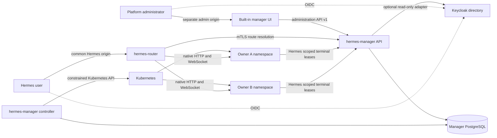
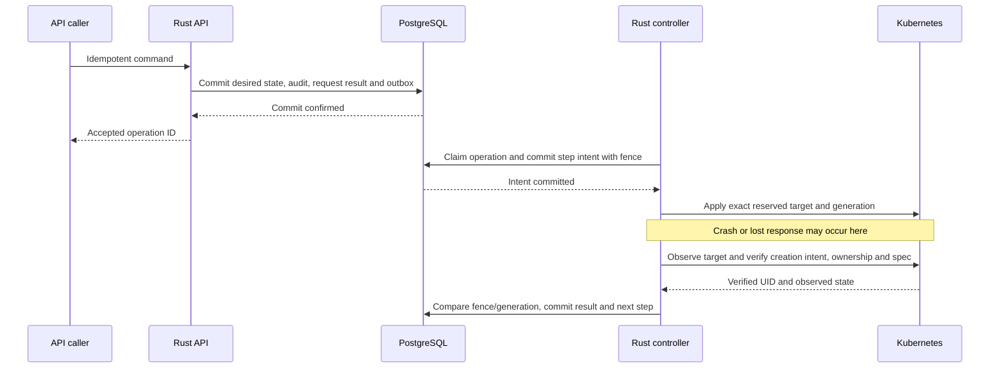
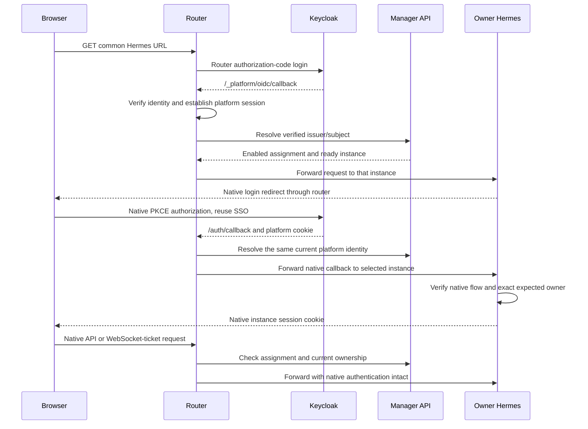

# Personal Hermes architecture

Status: proposed implementation architecture, based on release 0.6.1. None of
the new manager/router services or chart settings below exist in that release.
See the [specification](specification.md) and [delivery plan](plan.md).

## Ownership and sources of truth

Keycloak owns authentication, credentials, stable subjects and identity-provider
roles. One Rust manager owns assignments, Hermes instance provisioning, terminal
runtime policy, execution environments, leases and the registry of resources it
commissioned. PostgreSQL is the durable store for all manager control-plane
state. Kubernetes is the observed execution environment. Native Hermes content
and files remain in each owner's retained application storage.

The authorization decision is the conjunction of a valid identity, any
configured coarse identity-provider eligibility rule, an enabled manager
assignment and a ready instance owned by that exact identity. Authentication or
membership in a Keycloak group does not independently commission an instance.
Email changes do not change ownership. Deleting and recreating an identity with
the same email does not transfer its instance.

Administration initially lives inside `hermes-manager`. Extracting the panel
later must change deployment and presentation only, not these ownership rules.

## Implementation stack

Implement the new manager and OIDC authentication adapter in Rust. Use Axum/Tokio
for HTTP and asynchronous services, kube-rs for Kubernetes reconciliation, SQLx for
PostgreSQL and migrations, and the openidconnect crate for OIDC protocol work.
Keep domain types and application interfaces separate from framework adapters.
The manager serves its built-in React/TypeScript UI assets and versioned
administration API. Vite supplies the frontend development server and production
asset build; the production API/UI process remains Rust.

Use an official, pinned Traefik Proxy image with multi-layer routing, a separate
Rust ForwardAuth/OIDC adapter and a thin route-resolution middleware plugin.
The plugin queries the Rust manager for the destination after authentication.
This choice requires a local compatibility spike, including active WebSocket
revocation; the documented revocation bound remains a release gate. The platform
must not assume the Kubernetes distribution's bundled proxy supports the
required version.

[Traefik itself is written in Go](https://github.com/traefik/traefik); Rust is the
language of our manager and external authentication adapter. Use Go/Yaegi for
the small Traefik middleware plugin, with standard-library HTTP/mTLS only; the
plugin contains no SQL driver, OIDC flow, assignment rules or Kubernetes client.
The authentication adapter is a separate Rust HTTP service called through
built-in ForwardAuth. The plugin calls the manager's route API and supplies the
authorized instance/generation to built-in child routing. Traefik supports
[Go and WASM plugins](https://doc.traefik.io/traefik/extend/extend-traefik/), but
Rust/WASM networking is not assumed compatible without a separate prototype.

Routing is based on verified OIDC identity: `(issuer, subject)` selects the
enabled manager assignment and its registered instance. A routing header is only
an internal representation of that already-authorized result. Neither a browser
header nor an unverified decoded JWT is an identity or routing authority.

## Components



| Component | Responsibility | Credentials and privilege |
| --- | --- | --- |
| Manager API/UI | Administrator login, assignments, terminal-runtime/storage policy, scoped execution leases, status, audit and internal route resolution | Scoped manager database roles, admin OIDC client, optional directory reader and execution-client verifier; no Kubernetes token |
| Manager controller | Reconcile Hermes instances, terminal Pods and generations, expired leases, policy changes and coordinated lifecycle operations | Controller database role, constrained namespace bootstrap and instance-scoped Kubernetes bindings; the only manager role with Kubernetes credentials |
| Rust router auth adapter | Validate OIDC sessions and supply fresh verified identity evidence for the routing plugin | Router OIDC client and restricted session-store role; no Kubernetes token or assignment writes |
| Traefik proxy and routing plugin | Authenticate through ForwardAuth, query the manager, select a registered child backend and proxy native HTTP/WebSockets | Separate restricted ForwardAuth and manager mTLS clients, transient identity evidence and read-only generated configuration; no OIDC client secret, SQL credentials or Kubernetes token |
| Personal Hermes | Native dashboard, agent state, model onboarding and exact owner authentication | Its own home, native session keys and approved service credentials |
| Personal terminal worker | Non-root SSH execution for its owning Hermes, created on demand from approved image/mount policy | Its exact owner claims, selected key/Secret references and environment identity; no manager administration, database or Kubernetes credential |
| Deployment/backup integration | Database, storage classes, ingress, identity-provider clients, encryption and external recovery storage | Deployment-owned infrastructure credentials, never distributed to personal instances |

The API/UI and controller are two process roles in one new manager image, run as
separate Deployments. This keeps the initial product together while preventing
the browser-facing process from holding the controller's Kubernetes credential.
They are roles of one manager product with one PostgreSQL control model, not
separate assignment and execution managers. No per-Hermes manager Deployment,
SQLite lease database or worker-provisioning ServiceAccount is created.
The Rust router auth adapter is a second new platform image. Traefik uses its
official image. Together they implement the logical `hermes-router` component;
no separate frontend service is required yet.

## Administration boundary and future panel extraction

Proposed source boundaries:

```text
contracts/hermes-manager/openapi.yaml
contracts/hermes-manager/router.openapi.yaml # proposed resolver contract supplied now
services/hermes-manager/
  Cargo.toml                          # Rust workspace
  crates/hermes-domain/src/            # identity, assignments and instance invariants
  crates/hermes-application/src/       # commands, queries and interface traits
  crates/hermes-adapters/src/          # HTTP, PostgreSQL, directory and Kubernetes
  crates/hermes-manager/src/bin/       # API/UI and controller process roles
  crates/hermes-router-auth/src/       # OIDC sessions and ForwardAuth adapter
  ui/                                 # built-in administration presentation
plugins/hermes-route-resolver/          # thin Go/Yaegi middleware
```

Except for the [resolver contract](../../contracts/hermes-manager/router.openapi.yaml),
these paths describe work to create, not existing packages. Domain code imports
no HTTP, UI, Kubernetes or identity-provider SDK. Application code depends on
ports such as `AssignmentRepository`, `InstanceRepository`, `IdentityDirectory`,
`InstanceDriver`, `OperationQueue`, `AuditSink` and `CheckpointCoordinator`.
Add `TerminalRuntimeRepository`, `StorageBindingRepository`,
`ExecutionEnvironmentRepository`, `ExecutionLeaseRepository` and `ExecutionDriver`
for the execution domain. Keep instance commissioning and terminal execution as
separate application modules of this same manager, sharing transactional policy
and ownership records.
Rust traits express these ports; adapters implement them. HTTP endpoints invoke
application commands and queries using a validated actor, never a UI-supplied
administrator flag.

The browser UI calls the versioned administration API. It has no SQL connection,
Kubernetes client or direct directory access. API-only mode disables UI serving
while retaining the same contract and authorization. A later panel uses that API
with an administrator access token targeted at its audience; the manager still
validates the human actor and permissions. A panel service identity alone cannot
impersonate that administrator. API-only contract tests enforce this seam.

Serve administration on a separate origin, for example
`https://hermes-admin.example.org`, from `https://hermes.example.org`. Personal
assistant content must not share the administration session's browser origin.
Use separate OIDC clients, host-only cookies and explicit CSRF checks. Do not
enable broad credentialed CORS to make a later panel work.

### Dashboard build and API communication

Use React and TypeScript for the browser application, built with
[Vite](https://vite.dev/guide/build.html). Node.js and the frontend package
manager are build/development tools. Copy the locked production build into the
manager image and serve it from the Rust API/UI role. No Node.js or Vite server
is required in the production deployment.

The communication path is browser HTTPS requests to the Rust administration API,
then application commands/queries to PostgreSQL and the operation outbox. The
controller independently consumes committed operations and reconciles Kubernetes.
The UI never connects to PostgreSQL, holds a database credential or controls a
Kubernetes client. Instance status comes back through the same API.

Serve UI routes and `/api/v1/...` from the same administration origin initially.
The Rust manager owns OIDC login/callback handling, server-side administrator
sessions, host-only HttpOnly cookies, CSRF validation and all authorization.
The UI reads current actor/permissions and a browser CSRF token through a session
endpoint, and uses a typed client generated from the administration OpenAPI
contract. Keep provider access/refresh tokens out of browser storage and bundles.
Disabling a button is presentation, never an authorization decision.

Use relative API URLs, and proxy them to Rust during Vite development. Keep API,
authentication and unknown internal paths out of the SPA HTML fallback. Handle
`401`, `403`, `409` and `412` explicitly, refresh displayed status after commands,
and clear user-specific browser state on logout or identity switching.
Builds must use fixture data; live users, secrets and assignments cannot enter
static assets. The later panel can serve the same frontend build separately
while keeping the API contract and human-actor checks intact.

The optional directory adapter can search users and confirm canonical subjects
with read-only permissions. Exact issuer/subject entry remains available when
directory access is not configured. It never creates Keycloak users, changes
passwords, grants identity-provider roles or imports a Multica user directory.

## Durable identity and reconciliation

Persist an installation identity, exact issuer/subject identities, assignments,
instances, resource UID bindings, operations, checkpoint epochs and audit events.
The [specification](specification.md#durable-data-contract) defines the records.

An enabled assignment commits desired state and an outbox event in one SQL
transaction. A leased worker reconciles it without holding a SQL transaction
open across Kubernetes calls. Uniqueness constraints, deterministic names,
optimistic versions and operation fencing prevent duplicate instances. Before
publishing readiness or applying a destructive step, recheck desired generation,
lease ownership and observed Kubernetes UIDs.

Resources left by an interrupted attempt are reconciled only when installation,
instance, namespace and UID checks agree. A name or label match alone cannot
authorize adoption. Disable races cannot publish a usable route because route
resolution independently reads the current assignment on every request.

### Durable operation steps and restart recovery

The manager is a reconciler backed by PostgreSQL, with durable per-operation
steps. Committing only the final outcome is insufficient: every Kubernetes or
initialization action needs a committed intent before dispatch, followed by
observation and a fenced completion commit. The specification's
[persistence boundaries](specification.md#crash-recovery-and-persistence-boundaries)
apply to commissioning, terminal creation, policy changes, credentials, leases,
suspension, deletion and checkpoints.



Reserve resource identities, immutable input/policy references and create-once
bootstrap material before external writes. Use an authenticated creation marker
to bind an observed UID only to its exact outstanding creation intent; subsequent
UID changes remain conflicts. Record deletion intent before the delete call and
verify absence before completion. Use Kubernetes UID/resource-version
preconditions in addition to SQL fencing, and reconcile uncertain outcomes.
PostgreSQL and Kubernetes do not share an atomic transaction; retry convergence
comes from operation identities, idempotent actions and verified observations.
See [PostgreSQL reliability](https://www.postgresql.org/docs/current/wal-reliability.html)
and [Kubernetes API concurrency](https://kubernetes.io/docs/reference/using-api/api-concepts/).

On restart, validate schema/installation/recovery gates, reload durable pending
steps and timers, reclaim expired worker claims and relist registered resources.
Keep unexpired execution leases and existing healthy Pods; never reset lease or
idle deadlines to startup time. Periodic resync supplements watches/notifications.
If a non-idempotent initializer has no provable completion receipt, block that
operation for review. Recovery must pass forced-process-death tests, including
Kubernetes success before UID/result persistence and API success before a lost
response, without relying on graceful shutdown or an in-memory work queue.

## Instance namespaces and the elevated controller

The first implementation uses one namespace per personal instance, with names
derived from installation and random instance IDs, never from email addresses.
Each namespace contains its Hermes Service/Deployment, retained home and
workspace PVCs, native keys, optional provider credentials, a scoped execution
client credential and constrained terminal worker resources. The manager stays
in the control plane. A single Kubernetes cluster hosts these namespaces; this
adds no VM per user.

This choice lets Hermes and its execution Pods reference that owner's selected
PVCs without cross-namespace mounts or a globally shared home. For RWO storage,
the approved scheduling policy must co-locate consumers and reject unsupported
multi-node sharing. Storage backends and recovery placement remain deployment
inputs. Namespace separation is not a separate-kernel isolation guarantee.

The controller is elevated, but must not receive unrestricted cluster-admin or
a cluster-wide Secrets role. Use a small namespace-bootstrap ClusterRole for
Namespace lifecycle and constrained RoleBinding creation. Permit binding only a
specific instance-reconciler ClusterRole to the controller's fixed
ServiceAccount. That role becomes effective only through a RoleBinding inside
an owned instance namespace.

Install fail-closed admission policies before starting reconciliation. They
restrict controller-created namespace names/immutable installation labels and
RoleBinding namespace, role and subject. The controller must be unable to bind
itself into the control plane, system namespaces or another installation.
Admission tests must exercise the actual ServiceAccount; labels and naming
conventions are not RBAC enforcement. See Kubernetes's
[RBAC guidance](https://kubernetes.io/docs/concepts/security/rbac-good-practices/).

Inside an instance, permit only reviewed workload templates and volume/Secret
references. The shared Rust manager binds each execution client to one registered
instance and its explicit profile/runtime policy. The same constrained controller
creates Hermes resources and terminal Pods inside the owned namespace.
Worker admission binds its permitted image, ServiceAccount, security context and
exact PVC/Secret mounts to that instance. Never widen the current allowlist with
wildcards to accommodate dynamic users.

Default-deny networking admits the router to the native Hermes port, each Hermes
to the shared internal execution API and its own SSH worker endpoints, and only
approved service egress. Separate execution API listeners/Service ports from
administration, route resolution and checkpoints. An execution client cannot
call those other boundaries even if it can reach the manager host. Workers cannot
reach manager administration, PostgreSQL, another owner's backend or identity
administration. The deployment must verify its CNI enforces the required
[NetworkPolicies](https://kubernetes.io/docs/concepts/services-networking/network-policies/).
Hermes and workers have no Kubernetes API credential.

The control plane is trusted infrastructure: an operator controlling it or the
cluster can access instance secrets. The product does not expose that power as
a routine UI impersonation feature.

## Unified terminal lifecycle and database model

The new Rust manager replaces the execution responsibility of the legacy Python
`runtime-manager` in personal mode. Preserve the tested lease, idempotency,
parent/delegate joining, scope isolation, idle/recycle and draining behavior in
Rust. Do not deploy or wrap the old manager as an additional service in this
mode. Keep the release 0.6.1 singleton path working until explicit adoption.

Keep one desired Hermes gateway replica running for every enabled assignment,
including while its browser is closed and all terminal workers are idle. Native
cron and background integrations require that running gateway in this design.
The manager scales terminal execution independently according to its lease and
runtime policy. No HTTP-triggered Hermes scale-to-zero controller or activator is
part of this architecture. Explicit administrative suspension, maintenance and
recovery remain controlled lifecycle operations of the same Rust manager.

The manager database stores assignments, immutable terminal-runtime versions,
owner storage bindings, effective execution policies, scoped execution clients,
environments/generations, leases, operation/outbox records and audit. A Hermes
client authenticates to `/execution/v1/...`; its credential resolves the owning
instance server-side. Its native settings may choose an allowed `runtime_id`,
but image, mounts, resources and Kubernetes namespace come from PostgreSQL policy.
There is no per-instance execution configuration file as a competing source.

On lease acquisition, the API checks current assignment access and owner/runtime
scope, reserves an idempotent environment and commits a provisioning operation.
The controller reads the pinned policy generation, applies matching admission
rules and creates or reuses the exact terminal Pod. The API grants a lease and
SSH endpoint only after verified readiness. Existing clients can retry a bounded
`409` provisioning response using the same request ID. Commands flow directly
from Hermes over SSH to that worker; the manager does not proxy terminal bytes.
Recheck the current assignment and policy generation in the lease-grant
transaction so a revoke during provisioning cannot grant new execution.

Use unique scoped environment/request identities, short PostgreSQL transactions,
database-time lease expiry, row locks/optimistic versions and fenced controller
work. Do not hold a transaction across Kubernetes calls. Multiple API/controller
processes must not double-grant exclusive environments, revive an expired lease
or recreate a retired Pod generation. Release, expiry, session close, restart
and policy changes reconcile from the database, retaining owner data.

Keep the Hermes application image separate from its terminal runtime image.
Approved runtime versions carry exact image digests and the managed SSH contract.
Owner mount bindings resolve to exact namespace-local PVCs and read/write paths;
optional network-home claims are provisioned by the deployment's storage adapter.
The controller derives worker specs and admission from the same policy generation,
including namespace-local image-pull credentials. Storage drivers, private routes,
share ACLs and credential references remain deployment inputs. The
[terminal specification](specification.md#per-hermes-terminal-images-and-mounts)
defines selection, image compatibility, policy changes and external-data retention.

Policy changes fence new acquisitions and drain only affected environments before
activating a new generation. New work cannot start with a mismatched image,
mount set or admission policy. The React administration UI reports desired and
applied generations, active environments/leases and redacted conditions through
the Rust API; it has no direct database or Kubernetes access.

## Browser authentication and native Hermes sessions

Use normal OIDC authorization-code flows with S256 PKCE, state and nonce
validation. Pin trusted issuer, client audiences, algorithms, JWKS and exact
callback URLs; use an established maintained OIDC implementation. See
[OIDC authentication](https://openid.net/specs/openid-connect-core-1_0.html#CodeFlowAuth).
The initial implementation supports one configured issuer, while database keys
include the issuer so a future extension cannot collide subjects across issuers.

Use separate clients for the router, management interface and native Hermes.
Configure the router's Keycloak access token with the dedicated route-API
audience, separate from the administration audience, and prove that refresh
produces evidence within the required age bound.
The provider must issue the same public subject to router and native clients.
Pairwise subjects requiring cross-client identity linking are unsupported in
the first version; never substitute email matching.



This deliberately retains native Hermes authentication rather than inventing a
token-exchange or trusted-header login protocol. The two authorization handshakes
reuse identity-provider SSO; identity-provider policies may still require fresh
authentication. Prove compatibility against the pinned Hermes version before
releasing this design.

The platform callback is handled only by the router. Native callbacks are
forwarded only with a valid platform session and resolvable owner. Missing,
expired or switched platform sessions abort the native callback and require a
fresh flow; a callback code or its query parameters never select a backend.

The native adapter must verify the expected owner on login, every session check
and refresh. Release 0.6.1's generic native OIDC configuration is not evidence
that this owner pin exists. Add it as part of this work and test it independently
of routing. Give instances distinct persisted native session keys.

Store platform tokens and session records server-side with dedicated database
permissions and referenced encryption keys. Keep opaque Secure/HttpOnly host-only
cookies in the browser. Strip platform/admin cookies, unverified identity headers
and platform bearer tokens before forwarding to Hermes. Filter backend
`Set-Cookie` responses so an instance cannot replace reserved platform cookies.
Native cookie/header behavior stays within the tested allowlist.

Both platform and native sessions must end on logout, including when a backend
is unavailable. Identity switching must clear previous native cookies and reject
in-flight callbacks and tickets for the prior identity. Identity-provider-wide
logout is a separate configured policy, not an accidental cross-application side
effect.

## Routing and revocation

The Rust authentication adapter validates the OIDC session. The Traefik routing
plugin calls `POST /internal/v1/routes/resolve` on the Rust manager over mTLS.
That service identity can resolve routes but cannot create assignments or call
administrator/lifecycle commands. Browser ingress cannot address this internal
API. The manager independently validates the submitted identity evidence and
its binding to the requested issuer/subject before reading the assignment.

For the Traefik implementation, use the following ordered flow:

1. The common-host parent router removes incoming internal identity/routing
   headers, then calls the Rust adapter through authenticated ForwardAuth.
2. The adapter validates the OIDC session, derives the exact issuer/subject and
   returns transient internal identity headers and a fresh Keycloak access token
   targeted at the route API. The plugin relays that evidence to the manager.
   The manager validates issuer, audience, authorized OIDC client, signature,
   token lifetime/freshness and exact subject, then resolves the assignment.
3. Only a ready manager response permits the plugin to set internal instance
   and route-generation headers. A child router selects the registered Service
   for that exact pair. The returned namespace/Service/port describes the
   commissioned destination; the plugin cannot turn a response into an
   arbitrary new upstream URL.
   Children have no independent public entry point or authentication bypass.
   Missing authorization, unknown IDs and unmatched routes deny access.
4. Before forwarding to native Hermes, remove all internal identity/evidence
   and routing headers, plus platform cookies/tokens. Native owner verification
   remains enabled.

Explicit platform login/callback routes terminate at the Rust adapter, allowing
authentication to begin before a session exists. They expose no backend selection
or internal manager API. Every native Hermes route, including its callback and
WebSocket upgrade, passes through the authenticated parent pipeline.

The controller publishes only approved child routes and Services through the
file provider's versioned dynamic configuration, mounted read-only into Traefik.
It must not give the proxy Kubernetes credentials. Validate complete snapshots,
watch the mounted directory rather than a single projected file, and test atomic
reload behavior. Admission/readiness and the live assignment check remain
authoritative when a route snapshot is stale. The API/UI process cannot publish
arbitrary proxy configuration.

Traefik's
[multi-layer routing](https://doc.traefik.io/traefik/v3.7/reference/routing-configuration/http/routing/multi-layer-routing/)
supports authentication middleware before child selection. Ordinary single-layer
ForwardAuth alone does not define this backend-selection sequence. Use a reviewed
version/provider combination; this proposal uses the file provider, not ordinary
Kubernetes Ingress, Gateway API or the HTTP provider for hierarchical routes.

Return only a commissioned backend, route generation and authorization version
for that exact owner. Validate namespace and Service names against platform
formats and configured service domains. Never accept an arbitrary URL, port,
Host header, query target or forwarded identity as a destination.

No positive assignment cache is used initially. Manager/database failure denies
new requests. Long-lived WebSockets repeat authorization checks and close when
assignments change or identity evidence expires. Normal HTTP mutations are never
automatically replayed after backend failure. Forward streaming responses,
uploads and WebSocket upgrades without weakening native ticket/origin checks.
The specification fixes the timeout and revocation bounds to test.

ForwardAuth at upgrade time does not establish periodic authorization or closure
of an already-open WebSocket. Prove an explicit connection-revocation mechanism
with the pinned proxy/native combination before adopting Traefik. Do not claim
that removing a route closes existing streams or silently weaken the revocation
requirement to make the off-the-shelf proxy fit.

## Model credentials and Multica

A commissioned instance starts with generic software and no other person's
provider credentials, tokens, prompts or personal configuration. Its owner
completes supported native model-provider onboarding in that instance. Missing
model authentication is an explicit readiness condition for model use; it does
not make the owner share an operator login. Installation-configured enterprise
credentials, if enabled, use explicit owner-scoped Secret references.

External MLflow, SkyPilot or other service access is opt-in per assignment.
An optional `ServiceCredentialProvisioner` adapter consumes reviewed owner policy
and returns scoped references, not secrets in API responses. Its default grants
no external service access. Do not distribute an existing shared automation
account to new owners. User-delegated token exchange remains separate work.

Multiple native profiles belong to one owner and are not tenant boundaries.
Seed only missing state. Existing private settings and user-created content are
not overwritten by chart reconciliation. Multica connection is a separate
explicit owner-authenticated action, preserving its existing account and token
boundaries. A new manager assignment does not create a board membership.

## Recovery and teardown boundary

Dynamic instances invalidate a fixed backup dataset/Secret list. Before adoption,
the deployment integration must consume a versioned inventory containing all
instance IDs, owner keys, namespace/resource UID bindings, PVC datasets, selected
Secrets, template/image digests, terminal-runtime/storage policy and execution
environment/lease state from the shared manager database.

The manager exposes prepare, inventory, completion and resume interfaces to a
trusted checkpoint coordinator. Fence configuration changes and reconciliation,
drain work and stop all inventoried writers before exporting a consistent
registry and instance payload. The deployment supplies backup transport and
encryption. Require complete encrypted readback and a receipt bound to the
installation, checkpoint epoch and inventory digest before teardown can proceed.
No cloud key or deployment-specific backup script belongs in platform images.

Restore before admitting routes or commissioning new resources. Preserve stable
instance and OIDC identity keys; newly created Kubernetes objects receive new
UIDs, recorded through an explicit verified restore mapping. Old UIDs remain
provenance, not a false promise that Kubernetes will reuse them. Invalidate stale
platform sessions on restore. Never invent new assignments because registry data
is missing beside existing homes.

Suspension or revocation retains data. Namespace/PVC purge requires its own
audited lifecycle operation and retention decision. Helm uninstall must not
silently garbage-collect dynamic namespaces. The deployment's teardown guard
must finish its coordinated checkpoint before removing the control plane or VM.

## Chart and release ownership

Helm installs the manager API/UI, controller, router, shared policies and
installation-level configuration. The controller creates per-owner objects from
reviewed templates shipped with that same release. Chart and service code share
the typed template/policy contract; infrastructure consumers must not generate
manager configuration or one Pulumi resource per user.

The feature is opt-in. Keep the current singleton chart path until explicit
adoption succeeds, reject simultaneous direct singleton/router exposure at the
same hostname, and pin all new images by digest with the existing release set.
Personal mode installs only the shared Rust manager for both commissioning and
terminal lifecycle; it must not install legacy or per-owner runtime-manager
Deployments. Custom terminal image digests are approved database policy, separate
from the release-pinned Hermes/manager/router software images.
Do not create a Helm release per user or install software by downloading and
executing deployment scripts. Database/schema and backup-inventory compatibility
must be reviewed along with the image/chart upgrade.
