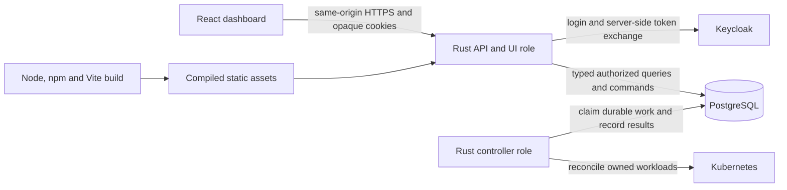

# Dashboard technology and implementation conventions

This is the technical companion to the [feature specification](dashboard-features.md)
and [build/authentication guide](dashboard.md). It records the selected direction
for the implemented dashboard. Installed versions are recorded in the lockfiles;
the [work plan](dashboard-workplan.md) records the original baseline, resolved
decisions and acceptance evidence. YAML 1.2 uses the pinned `yaml` parser and CodeMirror YAML language support.

## Stack and responsibility

| Layer | Technology | Status and responsibility |
| --- | --- | --- |
| Browser application | React, React DOM, TypeScript | Existing. Typed components and browser interaction; strict TypeScript checking. |
| Build/development | Vite with the React plugin, Node and npm | Existing. Development server, production compilation and code splitting; Node is a build/development tool. |
| Navigation | TanStack Router, `@tanstack/react-router` | Installed. Typed detail routes, validated URL search/filter state, links and unsaved-navigation handling. Use code-based route definitions, not the file-based Vite plugin and generated route tree, so build inputs stay explicit. |
| Tables | TanStack Table, `@tanstack/react-table` | Installed (Table v8). Headless column/selection/sort/filter state with accessible HTML tables; Rust performs collection queries. |
| Server data | TanStack Query, `@tanstack/react-query` | Installed. Query lifecycle, cancellation, in-memory caching, invalidation and bounded refresh. |
| Structured forms | React Hook Form, `react-hook-form` | Installed for template forms. Field state, dirty/touched tracking, array/object controls and mapping validation errors to fields. |
| Raw editor and diffs | CodeMirror 6, JSON language and lint/completion extensions | Installed after the Monaco production CSP spike failed. Lazy local chunks, JSON completion, pointer diagnostics and semantic changed-path review. React disposes editor state on unmount. |
| Browser schema validation | Versioned JSON Schema and Ajv, `ajv` | Installed. Consistent structural checks for form/raw drafts; precompiled validators preserve the script CSP. |
| YAML authoring | CodeMirror YAML language support and the pinned `yaml` parser | Installed. Strict JSON-compatible YAML converts to the shared JSON draft with bounded parsing and path diagnostics. |
| UI primitives | Radix Primitives, scoped `@radix-ui/react-*` packages | Installed Dialog for command/review dialogs with focus and keyboard behavior; native fields provide selects and other controls. |
| Appearance | Repository CSS and shared design tokens | Existing CSS and reusable table, status and command components. Preserve the current forest-green navigation, light surfaces, spacing and responsive layouts. |
| API contract | OpenAPI plus `openapi-typescript` | Existing generated TypeScript types. Extend the checked-in contract and regenerate types as endpoints are added. |
| HTTP/server runtime | Rust, Axum, Tokio | Existing. HTTPS, protected assets, administration API, authentication and request bounds. |
| Application policy | Rust domain/application modules and Serde | Existing. Authoritative validation, identity/ownership, permissions, versioning and lifecycle commands. |
| Schema generation/evaluation | Rust `schemars` and `jsonschema` | Installed. Generate schemas for typed manager inputs and validate reviewed runtime-specific configuration schemas; Rust policy checks remain required. |
| Persistence | PostgreSQL and SQLx | Existing. Manager records, sessions, audit, transactional operations, fenced controller work and versioned migrations. |
| Authentication | Keycloak OIDC through the Rust session implementation | Existing. Provider tokens stay server-side; the browser uses opaque cookies. PostgreSQL grants alone authorize administrators; token roles confer no permission. |
| Unit/browser tests | Vitest and Playwright | Existing. Expand client/component tests and real-browser workflow tests as features are added. |
| Backend tests | Rust tests, SQLx/PostgreSQL and HTTPS OIDC fixtures | Existing. Verify authorization and durable behavior independently of React. |
| Formatting and build checks | Prettier, `tsc`, Ruff, rustfmt, Clippy | Existing. Keep generated files and manually maintained files distinguishable. |
| Packaging | Multi-stage Docker build, GitHub Actions and finite build inputs | Existing local/CI pipeline. A non-root Rust runtime serves the compiled UI; release/chart publication remains separate. |

These choices prioritize typed contracts, good configuration assistance and
maintainable administration workflows. There is no single objectively best
frontend stack. Dependency novelty is not a substitute for tested validation,
accessibility, ownership and rollout behavior.

The authoritative installed versions are
[`ui/package.json`](../../services/hermes-manager/ui/package.json),
[`ui/package-lock.json`](../../services/hermes-manager/ui/package-lock.json),
[`Cargo.lock`](../../services/hermes-manager/Cargo.lock) and
[`rust-toolchain.toml`](../../services/hermes-manager/rust-toolchain.toml).
At this checkout, the frontend pins React/React DOM 19.3.1, TypeScript 5.9.3,
Vite 8.3.5, Node 26.11.1 and npm 11.20.0; Rust uses toolchain 1.99.1.
These are recorded repository versions, not a claim about the newest releases.
Check React/TypeScript peer compatibility and update exact pins and lockfiles
deliberately. The editor and validation dependencies are installed and bundled locally.

## Runtime and API architecture



Production has no frontend Node/Vite service. The manager image contains static
UI assets and Rust executables; API/UI and controller roles run with their
respective existing privileges. Only the controller receives its scoped
Kubernetes rights. The UI calls relative `/api/v1/...` URLs and Rust auth routes.
PostgreSQL queries and Keycloak directory access stay behind the Rust API.

OpenAPI describes HTTP requests/responses; generated TypeScript types support
the client. Configuration JSON Schemas describe editable template data. Keep
these two contracts coordinated without assuming an OpenAPI document is itself
the Hermes configuration schema. Neither TypeScript types nor a disabled button
replace server authorization or runtime validation.

Use the existing `src/api.ts` transport as the integration point for Query and
forms. Preserve same-origin cookies, JSON responses and explicit handling of
`401`, `403`, `409`, `412`, validation failures and dependency errors. API/auth
errors must retain their status and JSON shape. Rust controls which dashboard
paths receive SPA HTML; adding a client route requires a corresponding reviewed
server navigation route. The server registers all implemented list/detail routes explicitly and protects
flat JS/CSS assets through the same grant checks.

## Routing, tables and server data

TanStack Router provides for typed route and search-parameter
handling. Its search validation supports representing table state in URLs;
refer to the [official search-parameter guide](https://tanstack.com/router/latest/docs/guide/search-params).
Define resource-specific detail paths and validate IDs/versions/search state.
List URLs carry search text, supported filters, sort key/direction and cursor.
Changing the query resets the cursor. Use replace navigation for debounced
typing and normal history entries for deliberate navigation/filter changes.
Do not put draft configuration, credentials or provider tokens in URLs.

TanStack Table owns table interaction state and column definitions. The API owns
search, filtering, ordering and bounded pagination over the complete collection.
Do not apply a browser-only filter to one page and label it a database-wide
search. Server sort fields are allowlisted and use a deterministic tie-breaker;
cursor validity is tied to the chosen query/order. The initial implementation
should render bounded pages. Add TanStack Virtual only when measured row/column
rendering requires it; virtualization is a separate integration, as explained in
the [Table virtualization guide](https://tanstack.com/table/latest/docs/framework/react/guide/virtualization).

Query keys include the resource, canonical query/filter/sort/cursor inputs and
the active administrator context. Clear all user-specific query and draft state
on logout, identity switch or lost authorization. Keep this data in memory;
browser storage is not a default persistence mechanism for administrator data.
Propagate cancellation to fetches and discard stale validation/search results.
Use limited retries for transient read failures; `401`/`403` stop retries.

Successful mutations invalidate affected collections, details, references and
operation/status queries. Poll pending operations with bounded intervals and
stop when they reach a terminal state or the view is closed. The UI distinguishes
the acknowledged command from its eventual controller result. Query provides
the server-state lifecycle; see its [official overview](https://tanstack.com/query/latest/docs/framework/react/overview).

A mutation uses the current ETag/version and a stable idempotency key for retries
of that same intent/body. Reusing a key for an edited request is invalid.
Version conflicts show the newer record and preserve the unsaved draft for
comparison. Published versions, grants and rollout completion update from the
server result; optimistic presentation must not invent a completed deployment.

## Form and raw-editor model

React Hook Form manages user interaction and visible form field state. One
canonical parsed JSON draft belongs to a template-editing session; retain the
raw text separately so syntax errors are never discarded. The form and editor
are views of that session rather than independent saved objects. The library's
role is form state and validation integration; see the
[maintainer repository](https://github.com/react-hook-form/react-hook-form).

Parsing valid raw JSON updates the canonical draft and form projection. Form
edits merge the changed paths into the complete object, preserving supported
advanced fields. An invalid raw document keeps its text and diagnostics while
the form shows the last valid projection or explains why switching is blocked.
Represent a missing managed key separately from `null`, an empty value and a
default; removing an override can expose the user's retained Hermes setting.
Validation does not silently insert defaults or coerce configuration types.

The dedicated managed-settings section edits the template's `adminConfig`.
Show platform-enforced settings separately and refuse conflicting changes in
both editing modes. Suggestions for runtime IDs, templates and storage are
authorized API lookups. A suggestion selects a reference; it does not grant
access to that resource. Validate before publishing and assigning.

Keep dirty/validation/publishing/operation state distinct. Block accidental
navigation with an unsaved draft, support explicit discard and show a semantic
diff before publish/apply. Save drafts through the versioned draft API;
do not write drafts into live infrastructure desired-state rows. Infrastructure
ownership, immutable published versions and explicit rollout rules are defined
in the [feature specification](dashboard-features.md#template-versions-ownership-and-rollout).

## Schemas and validation

Use a versioned, reviewed schema registry with stable schema IDs, schema
revisions, content digests and compatibility metadata for the selected template
and pinned Hermes image. A template's `schemaVersion`, the schema document's
JSON Schema dialect and the Hermes image/software version are distinct values.
Do not choose a schema merely by resolving an arbitrary mutable image tag.

The implemented path is:

1. Generate the typed manager envelope schema from its Rust/Serde shape using
   Schemars. Declare numeric bounds, enums and policy constraints explicitly;
   deriving a type shape does not reproduce every custom Rust validator.
   [Schemars documents this Serde integration](https://docs.rs/schemars/latest/schemars/).
2. Supply reviewed Hermes/plugin configuration schemas tied to supported images.
   Preserve advanced fields where the model permits them and label unsupported
   paths as unvalidated. A complete Hermes schema cannot be inferred from the
   manager's generic `adminConfig` JSON object alone.
3. Use the same versioned schema documents for form metadata, Monaco diagnostics
   and browser structural validation. Start with a JSON Schema draft-07 subset
   proven by shared fixtures across the chosen tools; explicitly configure schema
   generation and validators instead of relying on differing defaults. OpenAPI
   retains its own declared dialect. Ajv documents its
   [dialect-specific behavior](https://ajv.js.org/json-schema.html).
4. Evaluate configuration against the reviewed schema in Rust using the
   `jsonschema` integration, then run the existing domain, ownership, reference
   and lifecycle checks. Rust is authoritative even when browser validation passes.
   The [Rust validator](https://docs.rs/jsonschema/latest/jsonschema/) supports
   reusable validators and explicit draft configuration.
5. Return errors with a canonical JSON Pointer, code, severity and safe message.
   Map the pointer to form controls and raw-editor ranges. Add line/column
   diagnostics for parse errors. Do not reflect credentials in validation output.

Build-time schema/type drift checks and shared valid/invalid fixture sets must
prove agreement across form, raw editor and server. Client validation is an aid;
unknown client schema revisions fall back to server validation and a clear
coverage indication. Keep schema/reference retrieval limited to reviewed local
or authenticated manager-owned resources; configuration cannot nominate arbitrary
network/file references. Validation must not execute user-selected image/plugin
code or commission a Pod as a side effect.

Use precompiled Ajv standalone validators for schemas bundled with the UI.
Do not require runtime JavaScript code generation in the authenticated page.
Verify the precompiled path against the production CSP when integrating it;
new server schema revisions without a bundled validator still have authoritative
server validation and available editor diagnostics. The editor/server capability
response must make that distinction visible. Configure validation so it does not
mutate the submitted draft through type coercion or default insertion.

Respect request/domain size and depth limits. The current administration request
body bound is 16 KiB and native template `adminConfig` is limited to 8 KiB of
serialized JSON. A large editor buffer does not raise these server limits. Any
limit change requires a coordinated API/schema/controller review.

## Editor spike and production assets

The Monaco 0.57 spike emitted ten served files. Its largest JavaScript chunk
was 2,737.79 kB; its two workers were 303.77 and 433.12 kB, and its codicon font
was 153.22 kB. Asset bounds were feasible, but the real Chromium run under Rust's
nonce CSP reported Monaco runtime style elements and inline style attributes
without valid nonce support. The work plan's fallback was therefore selected:
CodeMirror 6. Monaco, its workers and its font are not shipped.

The production CodeMirror build serves seven UI files: `index.html`, CSS, application,
shared model, bundler runtime, editor and raw-editor chunks. The largest chunk is
approximately 378 kB (124 kB gzip); the application chunk is approximately 331 kB. No worker
or font resource is required. Dependency licenses ship separately in
`/usr/share/doc/hermes-manager/THIRD_PARTY_NOTICES.txt`. The loader still accepts
only startup-loaded HTML and flat JS/CSS, at most 32 files, 4 MiB each and 16 MiB
in total. Paths never become general filesystem lookups.

Rust generates a fresh style nonce for each HTML response, puts it in the meta
placeholder and CSP, and CodeMirror and Radix consume it. `script-src 'self'`
remains unchanged; `worker-src 'self'` is explicit. There is no `unsafe-inline`,
`unsafe-eval`, blob worker, external schema fetch or CDN. Playwright runs the built
editor and Radix dialogs against the Rust HTTPS/OIDC/PostgreSQL fixture and checks
zero CSP violations, including real cookie/CSRF registration and draft publication.

JSON and YAML are supported raw formats. YAML converts to the same JSON model;
the pinned parser enforces JSON-compatible values and duplicate-key/tag/alias/
resource bounds. The API accepts JSON only, so both authoring formats receive
the same authoritative Rust validation.

## Components, styling and accessibility

Build a shared set of table, field, error-summary, status-badge, inspection,
confirmation, diff and operation-progress components. Use existing CSS with
central tokens for colors, typography, spacing, borders, focus and responsive
breakpoints. Radix supplies interaction primitives; application components supply
labels, layout, content and domain-specific behavior. Its documented support for
focus and keyboard patterns is useful for these interfaces; see the
[Radix accessibility guide](https://www.radix-ui.com/primitives/docs/overview/accessibility).

Keep semantic table headers, accessible names, visible focus and keyboard access
to row inspection/actions. Announce validation and asynchronous results without
stealing focus during typing. Dialogs return focus to their trigger; destructive
actions explain affected users/instances and default to a safe cancel action.
Use text alongside color for status. Support narrow screens, reduced motion and
large/long identifiers. Radix integration does not replace browser and assistive
technology testing or correct application labels.

## Authentication and state lifecycle

Use the existing Rust OIDC/session implementation. The React application does
not own a Keycloak client secret, provider access/refresh tokens or a browser
OIDC SDK session. Fetch the current actor, permitted actions and CSRF token from
`/api/v1/session`. Browser mutations carry CSRF plus normal version/idempotency
preconditions; Rust checks the actual actor and current policy.

Keycloak supplies the verified identity. PostgreSQL grants are checked on every
browser/bearer request and in mutation transactions. `canManageAdministrators`
controls grant writes, and the API reports effective permissions. Bootstrap,
recovery and immediate next-request revocation are documented in the
[operator guide](dashboard.md#keycloak-identity-and-postgresql-administrator-access).
The grant list queries actual grants; recent identities are only candidate targets.

Never persist provider credentials, user metadata or configuration drafts in
frontend bundles, URLs, telemetry or default browser storage. Logout clears
in-memory queries/forms and opens `/auth/signed-out`; it does not immediately
restart login. On identity changes and lost permission, remove the old actor's
data and stop outstanding queries. API-only mode retains the same commands,
authorization and audit behavior.

## Source organization and delivery checks

The frontend uses the modules below. Formatting recursively checks nested source
and browser-test files. Every input is enumerated in `release-policy.json`, and
a repository check rejects tracked UI files missing from that finite context.

```text
ui/src/
  app/                 router, providers, authenticated layout
  api/                 transport, query keys and domain API adapters
  generated/           generated OpenAPI types; do not edit by hand
  components/          shared tables, fields, dialogs and status components
  features/
    users/
    templates/         list/detail, form/raw editor, versions and managed config
    assignments/
    terminal-runtimes/
    administrators/
    activity/
  schemas/             reviewed schema assets/generated standalone validators
```

Keep generated outputs deterministic
and mark them separately from hand-maintained adapters/components.

The existing commands and CI entry points are in the
[dashboard guide](dashboard.md#frontend-development-and-checks). Extend them to
cover:

- Type/API/schema generation drift, strict TypeScript and formatting.
- Query cancellation/invalidation, error states and authentication cache clearing.
- Search/filter/sort pagination and table-to-detail navigation.
- Form/raw round trips, unknown-field preservation, schema revision compatibility,
  JSON/YAML diagnostics, schema suggestions and mandatory `adminConfig` policy.
- Version conflicts, idempotent retries, published-version immutability and exact
  user/template assignment outcomes through the API.
- Keyboard/focus behavior, unsaved navigation, responsive inspection and logout.
- Built production editor chunks/workers/fonts under Rust's real authentication,
  MIME, CSP and asset-size/count limits. Vite development tests alone are
  insufficient evidence for this integration.
- Rust/PostgreSQL authorization and lifecycle tests plus API-only workflows.

Production remains the existing multi-stage manager image. Update
`release-policy.json`'s finite development context whenever required build inputs
are added; keep environment files, credentials and live data outside it. Preserve
upstream dependency license notices. The current image/check jobs build without
publishing; new tagged releases, chart integration and deployed Keycloak acceptance
remain separate delivery steps.
