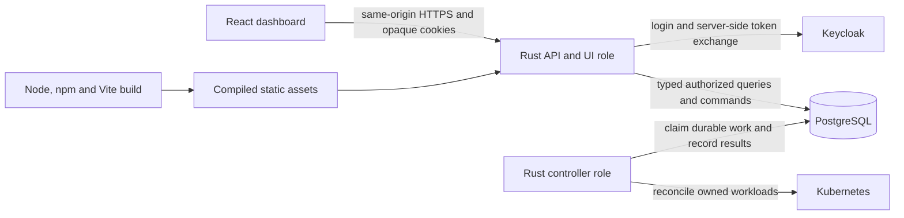

# Dashboard technology and implementation conventions

This is the technical companion to the [feature specification](dashboard-features.md)
and [build/authentication guide](dashboard.md). It records the selected direction
for extending the manager dashboard. **Existing** means present in source and
lockfiles. **Planned** means an implementation choice to add and verify; this
document does not install dependencies or implement the editors.

## Stack and responsibility

| Layer | Technology | Status and responsibility |
| --- | --- | --- |
| Browser application | React, React DOM, TypeScript | Existing. Typed components and browser interaction; strict TypeScript checking. |
| Build/development | Vite with the React plugin, Node and npm | Existing. Development server, production compilation and code splitting; Node is a build/development tool. |
| Navigation | TanStack Router, `@tanstack/react-router` | Planned. Typed detail routes, validated URL search/filter state, links and unsaved-navigation handling. Current navigation uses normal anchors and `window.location.pathname`. |
| Tables | TanStack Table, `@tanstack/react-table` | Planned. Headless column/selection/sort/filter state with accessible HTML tables; Rust performs collection queries. |
| Server data | TanStack Query, `@tanstack/react-query` | Planned. Query lifecycle, cancellation, in-memory caching, invalidation and bounded refresh. The scaffold currently calls a small typed `fetch` wrapper from React effects. |
| Structured forms | React Hook Form, `react-hook-form` | Planned. Field state, dirty/touched tracking, array/object controls and mapping validation errors to fields. |
| Raw editor and diffs | Monaco Editor, `monaco-editor` | Planned. Locally bundled JSON editing, documentation, completion, diagnostics and configuration diffs. React owns editor mounting/disposal; a wrapper is optional and must use local assets. |
| Browser schema validation | Versioned JSON Schema and Ajv, `ajv` | Planned. Consistent structural checks for form/raw drafts; precompiled validators preserve the script CSP. |
| Optional YAML authoring | Monaco YAML language integration and a reviewed YAML parser | Deferred until JSON/form editing works. `monaco-yaml` is the candidate language integration; YAML converts to the same JSON data model. |
| UI primitives | Radix Primitives, scoped `@radix-ui/react-*` packages | Planned. Dialogs, selects, popovers and tabs with focus/keyboard behavior; install components as needed. |
| Appearance | Repository CSS and shared design tokens | Existing CSS, planned reusable components/tokens. Preserve the current forest-green navigation, light surfaces, spacing and responsive layouts. |
| API contract | OpenAPI plus `openapi-typescript` | Existing generated TypeScript types. Extend the checked-in contract and regenerate types as endpoints are added. |
| HTTP/server runtime | Rust, Axum, Tokio | Existing. HTTPS, protected assets, administration API, authentication and request bounds. |
| Application policy | Rust domain/application modules and Serde | Existing. Authoritative validation, identity/ownership, permissions, versioning and lifecycle commands. |
| Schema generation/evaluation | Rust `schemars` and `jsonschema` | Planned integration candidates. Generate schemas for typed manager inputs and validate reviewed runtime-specific configuration schemas; Rust policy checks remain required. |
| Persistence | PostgreSQL and SQLx | Existing. Manager records, sessions, audit, transactional operations, fenced controller work and versioned migrations. |
| Authentication | Keycloak OIDC through the Rust session implementation | Existing. Provider tokens stay server-side; the browser uses opaque cookies. Current admin authorization requires the configured Keycloak client role. |
| Unit/browser tests | Vitest and Playwright | Existing. Expand client/component tests and real-browser workflow tests as features are added. |
| Backend tests | Rust tests, SQLx/PostgreSQL and HTTPS OIDC fixtures | Existing. Verify authorization and durable behavior independently of React. |
| Formatting and build checks | Prettier, `tsc`, Ruff, rustfmt, Clippy | Existing. Keep generated files and manually maintained files distinguishable. |
| Packaging | Multi-stage Docker build, GitHub Actions and finite build inputs | Existing local/CI pipeline. A non-root Rust runtime serves the compiled UI; release/chart publication remains separate. |

These choices prioritize typed contracts, good configuration assistance and
maintainable administration workflows. There is no single objectively best
frontend stack. Dependency novelty is not a substitute for tested validation,
accessibility, ownership and rollout behavior.

The authoritative installed versions are
[`ui/package.json`](../../services/hermes-manager/ui/package.json),
[`ui/package-lock.json`](../../services/hermes-manager/ui/package-lock.json),
[`Cargo.lock`](../../services/hermes-manager/Cargo.lock) and
[`rust-toolchain.toml`](../../services/hermes-manager/rust-toolchain.toml).
At this checkout, the scaffold pins React/React DOM 19.3.1, TypeScript 5.9.3,
Vite 8.3.5, Node 26.11.1 and npm 11.20.0; Rust uses toolchain 1.99.1.
These are recorded repository versions, not a claim about the newest releases.
Pin planned dependencies when they are introduced, check their React/TypeScript
peer compatibility and update the lockfile deliberately. No proposed library is
installed merely because it appears in this table.

## Runtime and API architecture



Production has no frontend Node/Vite service. The manager image contains static
UI assets and Rust executables; API/UI and controller roles run with their
respective existing privileges. Only the controller receives its scoped
Kubernetes rights. The UI calls relative `/api/v1/...` URLs and Rust auth routes.
PostgreSQL queries and Keycloak directory access stay behind the Rust API.

OpenAPI describes HTTP requests/responses; generated TypeScript types support
the client. Configuration JSON Schemas describe editable template data. Keep
these two contracts coordinated without assuming an OpenAPI document is itself
the Hermes configuration schema. Neither TypeScript types nor a disabled button
replace server authorization or runtime validation.

Use the existing `src/api.ts` transport as the integration point for Query and
forms. Preserve same-origin cookies, JSON responses and explicit handling of
`401`, `403`, `409`, `412`, validation failures and dependency errors. API/auth
errors must retain their status and JSON shape. Rust controls which dashboard
paths receive SPA HTML; adding a client route requires a corresponding reviewed
server navigation route. The existing server only serves the four scaffold
pages and protected flat JS/CSS assets.

## Routing, tables and server data

TanStack Router is the intended addition for typed route and search-parameter
handling. Its search validation supports representing table state in URLs;
refer to the [official search-parameter guide](https://tanstack.com/router/latest/docs/guide/search-params).
Define resource-specific detail paths and validate IDs/versions/search state.
List URLs carry search text, supported filters, sort key/direction and cursor.
Changing the query resets the cursor. Use replace navigation for debounced
typing and normal history entries for deliberate navigation/filter changes.
Do not put draft configuration, credentials or provider tokens in URLs.

TanStack Table owns table interaction state and column definitions. The API owns
search, filtering, ordering and bounded pagination over the complete collection.
Do not apply a browser-only filter to one page and label it a database-wide
search. Server sort fields are allowlisted and use a deterministic tie-breaker;
cursor validity is tied to the chosen query/order. The initial implementation
should render bounded pages. Add TanStack Virtual only when measured row/column
rendering requires it; virtualization is a separate integration, as explained in
the [Table virtualization guide](https://tanstack.com/table/latest/docs/framework/react/guide/virtualization).

Query keys include the resource, canonical query/filter/sort/cursor inputs and
the active administrator context. Clear all user-specific query and draft state
on logout, identity switch or lost authorization. Keep this data in memory;
browser storage is not a default persistence mechanism for administrator data.
Propagate cancellation to fetches and discard stale validation/search results.
Use limited retries for transient read failures; `401`/`403` stop retries.

Successful mutations invalidate affected collections, details, references and
operation/status queries. Poll pending operations with bounded intervals and
stop when they reach a terminal state or the view is closed. The UI distinguishes
the acknowledged command from its eventual controller result. Query provides
the server-state lifecycle; see its [official overview](https://tanstack.com/query/latest/docs/framework/react/overview).

A mutation uses the current ETag/version and a stable idempotency key for retries
of that same intent/body. Reusing a key for an edited request is invalid.
Version conflicts show the newer record and preserve the unsaved draft for
comparison. Published versions, grants and rollout completion update from the
server result; optimistic presentation must not invent a completed deployment.

## Form and raw-editor model

React Hook Form manages user interaction and visible form field state. One
canonical parsed JSON draft belongs to a template-editing session; retain the
raw text separately so syntax errors are never discarded. The form and editor
are views of that session rather than independent saved objects. The library's
role is form state and validation integration; see the
[maintainer repository](https://github.com/react-hook-form/react-hook-form).

Parsing valid raw JSON updates the canonical draft and form projection. Form
edits merge the changed paths into the complete object, preserving supported
advanced fields. An invalid raw document keeps its text and diagnostics while
the form shows the last valid projection or explains why switching is blocked.
Represent a missing managed key separately from `null`, an empty value and a
default; removing an override can expose the user's retained Hermes setting.
Validation does not silently insert defaults or coerce configuration types.

The dedicated managed-settings section edits the template's `adminConfig`.
Show platform-enforced settings separately and refuse conflicting changes in
both editing modes. Suggestions for runtime IDs, templates and storage are
authorized API lookups. A suggestion selects a reference; it does not grant
access to that resource. Validate before publishing and assigning.

Keep dirty/validation/publishing/operation state distinct. Block accidental
navigation with an unsaved draft, support explicit discard and show a semantic
diff before publish/apply. Save drafts through the future versioned draft API;
do not write drafts into live infrastructure desired-state rows. Infrastructure
ownership, immutable published versions and explicit rollout rules are defined
in the [feature specification](dashboard-features.md#template-versions-ownership-and-rollout).

## Schemas and validation

Use a versioned, reviewed schema registry with stable schema IDs, schema
revisions, content digests and compatibility metadata for the selected template
and pinned Hermes image. A template's `schemaVersion`, the schema document's
JSON Schema dialect and the Hermes image/software version are distinct values.
Do not choose a schema merely by resolving an arbitrary mutable image tag.

The planned path is:

1. Generate the typed manager envelope schema from its Rust/Serde shape using
   Schemars. Declare numeric bounds, enums and policy constraints explicitly;
   deriving a type shape does not reproduce every custom Rust validator.
   [Schemars documents this Serde integration](https://docs.rs/schemars/latest/schemars/).
2. Supply reviewed Hermes/plugin configuration schemas tied to supported images.
   Preserve advanced fields where the model permits them and label unsupported
   paths as unvalidated. A complete Hermes schema cannot be inferred from the
   manager's generic `adminConfig` JSON object alone.
3. Use the same versioned schema documents for form metadata, Monaco diagnostics
   and browser structural validation. Start with a JSON Schema draft-07 subset
   proven by shared fixtures across the chosen tools; explicitly configure schema
   generation and validators instead of relying on differing defaults. OpenAPI
   retains its own declared dialect. Ajv documents its
   [dialect-specific behavior](https://ajv.js.org/json-schema.html).
4. Evaluate configuration against the reviewed schema in Rust using the planned
   `jsonschema` integration, then run the existing domain, ownership, reference
   and lifecycle checks. Rust is authoritative even when browser validation passes.
   The [Rust validator](https://docs.rs/jsonschema/latest/jsonschema/) supports
   reusable validators and explicit draft configuration.
5. Return errors with a canonical JSON Pointer, code, severity and safe message.
   Map the pointer to form controls and raw-editor ranges. Add line/column
   diagnostics for parse errors. Do not reflect credentials in validation output.

Build-time schema/type drift checks and shared valid/invalid fixture sets must
prove agreement across form, raw editor and server. Client validation is an aid;
unknown client schema revisions fall back to server validation and a clear
coverage indication. Keep schema/reference retrieval limited to reviewed local
or authenticated manager-owned resources; configuration cannot nominate arbitrary
network/file references. Validation must not execute user-selected image/plugin
code or commission a Pod as a side effect.

Use precompiled Ajv standalone validators for schemas bundled with the UI.
Do not require runtime JavaScript code generation in the authenticated page.
Verify the precompiled path against the production CSP when integrating it;
new server schema revisions without a bundled validator still have authoritative
server validation and available editor diagnostics. The editor/server capability
response must make that distinction visible. Configure validation so it does not
mutate the submitted draft through type coercion or default insertion.

Respect request/domain size and depth limits. The current administration request
body bound is 16 KiB and native template `adminConfig` is limited to 8 KiB of
serialized JSON. A large editor buffer does not raise these server limits. Any
limit change requires a coordinated API/schema/controller review.

## Monaco, workers and production assets

Load Monaco only when entering a configuration editor or diff view. Bundle the
editor, language workers and required fonts locally through Vite. Dispose models,
listeners and completion providers when their editing session ends. Stable model
URIs connect the correct schema to each template/configuration object. Monaco's
[maintainer documentation](https://github.com/microsoft/monaco-editor) describes
models, language services and worker integration.

JSON editing is the first supported raw format. YAML is a separate integration;
syntax coloring alone is not YAML schema validation. If added, use a reviewed
parser and [Monaco YAML language service](https://github.com/remcohaszing/monaco-yaml),
require JSON-compatible data and define duplicate-key, tag, alias and resource
limits. Preserve semantic values across mode changes and explain any comment or
formatting normalization. YAML must not enable executable/custom constructors.

The current Rust asset loader accepts flat JS/CSS assets with bounded count and
size. Editor integration needs explicit support for its actual worker, chunk and
font outputs and a reviewed asset inventory/MIME mapping. Retain bounded,
startup-loaded assets and authenticated delivery, including worker requests;
request paths must never become general filesystem lookups. Measure bundle sizes
and update the limits only with the required outputs understood.

Serve workers from the same origin with credentials appropriate for the existing
session gate. Add the required explicit worker CSP directive when implementing
this; the current `default-src 'none'` policy does not itself permit workers.
Test Monaco and Radix under the actual production policy, including runtime
styles/positioning. Review any narrowly scoped style policy adjustments while
preserving script restrictions. Configure editor loading and schema resolution
to use the bundled or manager-served resources, without a public CDN dependency.

## Components, styling and accessibility

Build a shared set of table, field, error-summary, status-badge, inspection,
confirmation, diff and operation-progress components. Use existing CSS with
central tokens for colors, typography, spacing, borders, focus and responsive
breakpoints. Radix supplies interaction primitives; application components supply
labels, layout, content and domain-specific behavior. Its documented support for
focus and keyboard patterns is useful for these interfaces; see the
[Radix accessibility guide](https://www.radix-ui.com/primitives/docs/overview/accessibility).

Keep semantic table headers, accessible names, visible focus and keyboard access
to row inspection/actions. Announce validation and asynchronous results without
stealing focus during typing. Dialogs return focus to their trigger; destructive
actions explain affected users/instances and default to a safe cancel action.
Use text alongside color for status. Support narrow screens, reduced motion and
large/long identifiers. Radix integration does not replace browser and assistive
technology testing or correct application labels.

## Authentication and state lifecycle

Use the existing Rust OIDC/session implementation. The React application does
not own a Keycloak client secret, provider access/refresh tokens or a browser
OIDC SDK session. Fetch the current actor, permitted actions and CSRF token from
`/api/v1/session`. Browser mutations carry CSRF plus normal version/idempotency
preconditions; Rust checks the actual actor and current policy.

The current gate is the Keycloak management-client role documented in the
[operator guide](dashboard.md#keycloak-administrator-access). The proposed
PostgreSQL administrator-grant list is separate backend authorization work.
React components must consume capabilities from the API so that changing the
authority updates browser and bearer authorization consistently. A table showing
session subjects cannot serve as the authoritative list of all administrators.

Never persist provider credentials, user metadata or configuration drafts in
frontend bundles, URLs, telemetry or default browser storage. Logout clears
in-memory queries/forms and opens `/auth/signed-out`; it does not immediately
restart login. On identity changes and lost permission, remove the old actor's
data and stop outstanding queries. API-only mode retains the same commands,
authorization and audit behavior.

## Source organization and delivery checks

The scaffold currently has `src/main.tsx`, `src/api.ts`, `src/style.css`, generated
API types and client/browser tests. As features grow, use these logical modules:

```text
ui/src/
  app/                 router, providers, authenticated layout
  api/                 transport, query keys and domain API adapters
  generated/           generated OpenAPI types; do not edit by hand
  components/          shared tables, fields, dialogs and status components
  features/
    users/
    templates/         list/detail, form/raw editor, versions and managed config
    assignments/
    terminal-runtimes/
    administrators/
    activity/
  schemas/             reviewed schema assets/generated standalone validators
```

This tree is a target organization, not a list of existing files. Introduce
modules as their features are implemented. Keep generated outputs deterministic
and mark them separately from hand-maintained adapters/components.

The existing commands and CI entry points are in the
[dashboard guide](dashboard.md#frontend-development-and-checks). Extend them to
cover:

- Type/API/schema generation drift, strict TypeScript and formatting.
- Query cancellation/invalidation, error states and authentication cache clearing.
- Search/filter/sort pagination and table-to-detail navigation.
- Form/raw round trips, unknown-field preservation, schema revision compatibility,
  JSON/YAML diagnostics, schema suggestions and mandatory `adminConfig` policy.
- Version conflicts, idempotent retries, published-version immutability and exact
  user/template assignment outcomes through the API.
- Keyboard/focus behavior, unsaved navigation, responsive inspection and logout.
- Built production editor chunks/workers/fonts under Rust's real authentication,
  MIME, CSP and asset-size/count limits. Vite development tests alone are
  insufficient evidence for this integration.
- Rust/PostgreSQL authorization and lifecycle tests plus API-only workflows.

Production remains the existing multi-stage manager image. Update
`release-policy.json`'s finite development context whenever required build inputs
are added; keep environment files, credentials and live data outside it. Preserve
upstream dependency license notices. The current image/check jobs build without
publishing; new tagged releases, chart integration and deployed Keycloak acceptance
remain separate delivery steps.
