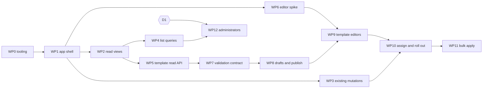

# Manager dashboard work plan

This is the executable breakdown of the [feature specification](dashboard-features.md)
and [stack conventions](dashboard-stack.md). Each work package (WP) is sized for
one reviewable pull request, lists the files it is expected to touch, and ends
with checks that prove it is done. Pick a package whose dependencies are merged
and whose blocking decisions are resolved. Do not start a package by guessing an
unresolved decision; implement the documented default only where one is given.

The baseline below records source at commit `c4a0a69` before implementation.
Current implementation evidence is recorded in Status; the baseline and package
acceptance criteria are retained to make the change reviewable. The user authorized
continuing through all unblocked packages in this workspace.

## Original baseline (before implementation)

### Frontend

| Item | Current state |
| --- | --- |
| Source | `ui/src/main.tsx` (single component, ~430 lines), `ui/src/api.ts` (typed `fetch` wrapper), `ui/src/style.css`, `ui/src/generated/api.ts`, `ui/src/api.test.ts`, `ui/e2e/dashboard.spec.ts` |
| Runtime dependencies | `react`, `react-dom` only |
| Navigation | Four hard-coded paths read from `window.location.pathname`; full page loads between them |
| Data | One `useEffect` per path fetches the first 50 rows; no pagination, cursor or refresh beyond a manual counter |
| Errors | `ApiError` keeps only the HTTP status. The JSON `error` code (`assignment_exists`, `template_unavailable`, `idempotency_conflict`, ...) is discarded |
| Actions | Logout only. `permittedActions` from `/api/v1/session` is fetched but not used to gate anything |
| Tests | Vitest for `api.ts`; Playwright presentation tests against `vite dev` with `page.route` fixtures |
| Formatting | `format:check` globs `src/*.ts src/*.tsx src/*.css` — **nested directories are not checked** |

### Rust serving boundary (`crates/hermes-adapters/src/http/dashboard.rs`)

| Constraint | Value | Consequence for new work |
| --- | --- | --- |
| SPA navigation routes | Exactly `/`, `/assignments`, `/terminal-runtimes`, `/activity` | Every new client route (including detail routes) needs a matching server route; otherwise a reload returns JSON `404` |
| Asset types | Flat `assets/*.js` and `assets/*.css`; anything else fails startup | Fonts (`.ttf`/`.woff2`), source maps, nested chunk directories and worker files with other extensions are rejected |
| Asset limits | ≤ 32 files incl. `index.html`, ≤ 4 MiB each, ≤ 16 MiB total | Monaco with default language chunks exceeds the file count |
| CSP on UI responses | `default-src 'none'; script-src 'self'; style-src 'self'; img-src 'self' data:; connect-src 'self'; base-uri 'none'; form-action 'self'; frame-ancestors 'none'` | Same-origin worker scripts are already allowed (`worker-src` falls back to `script-src`); `blob:` workers, injected `<style>` elements and fonts are not |

### Administration API (`contracts/hermes-manager/openapi.yaml`)

| Operation | Method/path | Used by UI |
| --- | --- | --- |
| `getAdministrationSession` | `GET /api/v1/session` | Yes |
| `listAssignments` | `GET /api/v1/assignments?after&limit` | First page only |
| `listTerminalRuntimes` | `GET /api/v1/terminal-runtimes?after&limit` | First page only |
| `listAuditEvents` | `GET /api/v1/audit-events?after&limit` | First page only |
| `listIdentities` | `GET /api/v1/identities?after&limit` | No |
| `listInstanceTemplates` | `GET /api/v1/templates` (≤ 1000, no paging) | No |
| `createAssignment` | `POST /api/v1/assignments` | No |
| `getAssignment` / `setAssignmentAccess` | `GET`/`PATCH /api/v1/assignments/{id}` | No |
| `getInstance` / `retryInstanceReconciliation` | `GET /api/v1/instances/{id}`, `POST .../reconcile` | No |
| `getOperation` | `GET /api/v1/operations/{id}` | No |
| `listTerminalRuntimeVersions` / `registerTerminalRuntime(Version)` | `/api/v1/terminal-runtimes[/{id}/versions]` | No |
| Storage bindings | `GET`/`POST /api/v1/storage-bindings`, `GET`/`PATCH .../{id}` | No |
| `getAssignmentExecution` / `setAssignmentExecution` | `/api/v1/assignments/{id}/execution` | No |
| `registerOwnerPullSecretBinding` | `POST /api/v1/instances/{id}/pull-secret-bindings` | No |

Mutations require `Idempotency-Key`; updates require a strong `If-Match`
(`"<version>"`); all return `202` with `Accepted {assignmentId, instanceId,
operationId, version}` or a JSON `Error {error: <code>}`.

### Gaps between the specification and the API

These are backend prerequisites, not frontend tasks:

1. **No search, filter or sort parameters** exist on any list endpoint; only
   `after`/`limit`. The terminal-runtime list uses a runtime-ID cursor, the
   others a UUID cursor.
2. **Two template concepts.** `GET /api/v1/templates` returns approved catalog
   versions (`id`, `version`, `image`, `nativePort`, `nativeScheme`). The
   editable definition with resources, storage and `adminConfig` lives in
   `manager.infrastructure_templates` (infrastructure-owned, see the
   [native commissioning guide](native-commissioning.md)) and is not exposed.
   There is no template detail, condition, `rejected_definition` or
   assigned-user query.
3. **No ownership/source field** on `Assignment`. API-created assignments and
   infrastructure `desired_users` mappings are indistinguishable to the UI.
4. **No template change on an assignment.** `PATCH /assignments/{id}` changes
   `access` only.
5. **Validation errors are codes only.** `Error` has no JSON Pointer, severity
   or message list, so path-addressed form/editor errors are impossible today.
6. **Audit is assignment-centric.** `AuditEvent.assignmentId` and `operationId`
   are required, so template, schema or administrator-grant events cannot be
   represented without a contract change.
7. **No per-instance operation history**; only `GET /operations/{id}` for a
   known operation ID.
8. **`permittedActions` enum** has no template, draft, publish or administrator
   actions.

## Resolved implementation decisions

| ID | Decision | Blocks | Documented default |
| --- | --- | --- | --- |
| D1 | Keycloak verifies identity; PostgreSQL grants alone authorize administrators. No role prerequisite or fallback. Explicit operator bootstrap/recovery. | Resolved by maintainer | Implemented |
| D2 | Dedicated manager-owned draft/version tables; infrastructure rows read-only. | Resolved default | Implemented |
| D3 | Pin assignment versions; explicit per-assignment or selected bulk apply. | Resolved default | Implemented |
| D4 | CodeMirror 6 fallback after Monaco's nonce CSP production spike failed. | Resolved by WP6 evidence | Implemented |
| D5 | Fresh per-response style nonce; script CSP remains self-only. | Resolved default | Implemented |
| D6 | Checked-in reviewed Hermes keys tied to the recorded image digest; other keys/unknown images visibly unvalidated. | Resolved default | Implemented |

## Rules for every package

- Keep each package to the listed scope. Note discovered follow-up work in this
  file instead of widening the pull request.
- Add **every** new build input (UI source, tests, scripts, schemas, Rust
  files, migrations) to `release-policy.json` under
  `development_contexts.hermes-manager.files`. The image build stages only
  enumerated files, so an omitted file fails `agent_platform.manager_build`.
- Contract first: edit `contracts/hermes-manager/openapi.yaml`, run
  `npm run generate`, and commit the regenerated `src/generated/api.ts`.
  Never hand-edit generated files.
- Pin every new npm dependency exactly (`.npmrc` sets `save-exact`), check React
  19 peer ranges and review the lockfile diff. No CDN, no runtime code generation
  (`new Function`/`eval`), no telemetry.
- Gate controls on `permittedActions`, and still handle `403` from the server.
- Fixtures and screenshots use synthetic identities such as
  `https://sso.example.org/realms/agents` / `fixture-admin`. No real subjects,
  emails, images or credentials.
- Run before pushing, from `services/hermes-manager/ui`:
  `npm run check:generated && npm run format:check && npm test && npm run build && npm run test:e2e`;
  for Rust changes `cargo fmt --all --check`, `cargo clippy --workspace --all-targets --locked -- -D warnings`
  and `cargo test --workspace --locked` in `services/hermes-manager` (database
  tests need `DATABASE_URL` for a disposable PostgreSQL, as in
  `.github/workflows/checks.yml`); from the
  repository root `uv run python -m agent_platform.manager_build` when build
  inputs, assets or the Dockerfile change, plus the repository checks in `AGENTS.md`.

## Work packages

### WP0 — Frontend tooling for a multi-file app

- **Goal:** let the source tree grow without silently skipping checks.
- **Touch:** `ui/package.json` (`format:check` → `prettier --check "src/**/*.{ts,tsx,css}" "e2e/**/*.ts" "*.{html,ts}"`;
  add `"test": "vitest run"` with a `src/**/*.test.{ts,tsx}` include), `release-policy.json`.
- **Add:** a pytest in `tests/test_manager_contracts.py` asserting that every
  tracked file under `services/hermes-manager/ui/` except `dist/`,
  `test-results/` and `node_modules/` is listed in the hermes-manager build
  context, so a forgotten entry fails `uv run pytest` rather than the image build.
- **Done when:** checks pass; deliberately unformatted nested file fails `format:check`.

### WP1 — Application shell, routing and server state

- **Depends:** WP0.
- **Install:** `@tanstack/react-router`, `@tanstack/react-query`. Use
  **code-based** route definitions (no router Vite plugin or generated route
  tree), keeping build inputs finite and reviewable.
- **Touch:** split `main.tsx` into `app/` (router, `QueryClient`, authenticated
  layout, navigation), `api/` (transport, query keys), and `features/{overview,assignments,terminal-runtimes,activity}/`.
  Preserve the existing look and copy.
- **Transport:** extend `ApiError` with the parsed `error` code (if the body is
  the JSON `Error` shape) and the status; map codes to messages in one table.
  Add helpers for `Idempotency-Key` (UUID per user intent, reused only for a
  retry of the identical body), `If-Match` from a stored ETag, and `X-CSRF-Token`
  for cookie sessions.
- **Session:** `useSession()` query with `staleTime` ≈ 60 s. On `401`/`403` or
  logout: `queryClient.clear()` and drop drafts; on `401` navigate to
  `/auth/login?returnTo=<path>`; on `403` render the no-access page.
  Queries: `retry` ≤ 2 for `503`/network, none for `4xx`; `refetchOnWindowFocus`
  enabled only for operation/status queries.
- **Server:** none (same four paths).
- **Done when:** client-side navigation between the four views works without a
  full reload and with reload; Vitest covers code mapping, retry policy and cache
  clearing on logout/`401`; existing e2e tests pass unchanged in intent.

### WP2 — Read views on existing endpoints

- **Depends:** WP1.
- **Install:** `@tanstack/react-table`; Radix packages only as needed (e.g.
  `@radix-ui/react-dialog` for inspection panels).
- **Client:** shared `DataTable` (semantic `<table>`, caption, sortable headers
  disabled until WP4), cursor pager (Next/First with cursor stack in the URL
  search params), `StatusBadge` (text + colour), loading/empty/error/forbidden
  states, copyable long-ID cell.
- **Views and routes:**
  - `/assignments` (paged) and `/assignments/$id` → `getAssignment`, `getInstance`,
    `getAssignmentExecution` (read-only panels).
  - `/users` → `listIdentities` (paged; "directory verified" column).
  - `/templates` → `listInstanceTemplates` (catalog versions; labelled as
    approved catalog versions until WP5 adds definitions).
  - `/terminal-runtimes` (paged) and `/terminal-runtimes/$id` → `listTerminalRuntimeVersions`.
  - `/storage-bindings` and `/storage-bindings/$id`.
  - `/activity` (paged), linking `assignmentId` to the assignment detail.
- **Server:** add the new navigation paths in `http/dashboard.rs` as explicit
  routes; detail paths match a single UUID or runtime-ID segment. Add Rust tests:
  each route returns the SPA HTML only after admin authorization, unknown
  paths (`/users/x/y`, `/api/v1/nope`) keep JSON errors.
- **Out of scope:** search, filters, sorting, any mutation.
- **Done when:** Playwright fixtures cover paging forward/back, detail
  navigation, deep-link reload, empty and `503` states; a keyboard-only pass
  reaches every row action; narrow viewport has no horizontal page scroll.

### WP3 — Workflows for existing mutations

- **Depends:** WP1 (WP2 for detail pages).
- **Workflows**, each gated by its `permittedActions` value:
  - Create assignment (`assignment.create`): identity picker from
    `listIdentities` plus manual exact `(issuer, subject)` entry, template from
    `listInstanceTemplates`, optional version, initial access.
  - Suspend/revoke/enable (`assignment.set_access`) with `If-Match` and a
    confirmation dialog stating routing denial and data retention.
  - Retry reconciliation (`instance.retry`).
  - Execution policy edit (`execution.policy.set`), runtime and runtime-version
    registration, storage-binding create/update, pull-secret binding — one
    dialog each, plain typed forms (no schema editor).
- **Operation tracking:** after `202`, show "accepted", then poll
  `getOperation` (1 s, backing off to 10 s, stop at a terminal state, view close
  or 10 min) and invalidate the affected assignment/instance queries.
- **Conflicts:** `412` refetches and shows current vs submitted values;
  `409 assignment_exists`/`idempotency_conflict` and `422` show specific text.
- **Done when:** Vitest covers key reuse on retry and a new key on an edited
  body; Playwright covers each dialog, `412` and polling termination; a
  Rust/PostgreSQL browser-session test exercises one cookie+CSRF mutation
  through the served UI origin.

### WP4 — Server-side list queries (backend)

- **Depends:** WP2.
- **Contract:** for identities, assignments, audit events and terminal runtimes
  add `q` (bounded substring/prefix on documented fields), endpoint-specific
  enum filters (`access`, `state`, `templateId`, `action`, `actor`), `sort`
  from an allowlist with deterministic `id` tie-break, and an opaque signed or
  query-bound cursor that is rejected (`422`) when reused with different
  query/sort. Keep `limit` ≤ 100. Reject unknown fields as today.
- **Rust:** SQLx queries with indexes/migration as needed; parameterized only.
- **Client:** wire search/filter/sort into URL search params validated by the
  router; reset the cursor on change; debounce text input with replace navigation.
- **Done when:** PostgreSQL tests prove stable ordering across pages under
  concurrent inserts, cursor/query mismatch rejection and index use for the
  default sort; Playwright covers URL round trip.

### WP5 — Template definition read API (backend)

- **Depends:** WP2. Respects D2 (read-only either way).
- **Contract:** `GET /api/v1/template-definitions` and `/{id}` returning the
  typed definition (image, storage class, capacities, CPU/memory, `adminConfig`),
  `source` (`infrastructure` | `manager`), controller `condition`,
  `rejectedDefinition` diagnostics, catalog versions with content digest, and
  assigned-user count. Add `GET /api/v1/assignments?templateId=` (WP4) for the
  assigned-users link, and `source` on `Assignment` (gap 3).
- **Client:** `/templates/$id` with Summary, Deployment, Managed configuration
  (read-only JSON view plus the three-layer explanation from the specification),
  Versions and Assigned users tabs.
- **Done when:** contract tests prove no credentials or manifests are exposed;
  Rust tests cover a rejected definition; UI shows infrastructure-owned rows as read-only.

### WP6 — Editor and asset-serving spike

- **Depends:** WP1. Resolves D4 and D5.
- **Do:** behind a temporary `/dev/editor` route excluded from navigation,
  load Monaco via `monaco-editor/esm/vs/editor/editor.api` plus the JSON
  language contribution only, workers via Vite `?worker` imports. Build and
  serve through the Rust image, not `vite dev`.
- **Harness (permanent deliverable):** today Playwright only runs against
  `vite dev`, so nothing checks the production CSP or asset loader in a
  browser. Add a second Playwright project that targets a locally started
  `hermes-manager api` with the built `ui/dist`, a disposable PostgreSQL and a
  signed OIDC provider fixture (extracted from the Rust browser tests if needed), and fails on any `securitypolicyviolation`
  event or console CSP error. WP9 and later packages reuse it.
- **Measure and record here:** number and size of emitted files, font and
  worker file types, any `blob:` worker usage, injected `<style>` elements,
  CSP violations in the Chromium console under the production policy.
- **Pass criteria:** ≤ 32 files total after the app's own chunks, no file
  > 4 MiB, no `blob:` or `eval`, JSON schema completion/diagnostics working with a
  locally bundled schema, styles working under the D5 choice.
- **Server changes this may require** (land in this package, with tests):
  `.woff2`/`.ttf` with `font/*` MIME, `font-src 'self'`, explicit `worker-src 'self'`,
  the D5 style policy, and revised file-count/size limits justified by measurements.
- **Fallback:** repeat with CodeMirror 6 (`@codemirror/lang-json` and a JSON
  schema extension); CodeMirror uses no workers and supports a CSP style nonce.
- **Done when:** the decision and measurements are recorded in
  [dashboard-stack.md](dashboard-stack.md); the spike route is removed or
  converted into the WP9 component.

### WP7 — Validation error contract and schema registry

- **Depends:** WP5. Resolves D6.
- **Contract:** a `ValidationProblem` response for `422` on configuration
  endpoints: `{error: "invalid_configuration", problems: [{pointer, code,
  severity, message}]}`, bounded count, messages without submitted values.
  Add `POST /api/v1/template-definitions/validate` (no persistence).
- **Schemas:** checked-in `contracts/hermes-manager/schemas/` with the template
  envelope (generated from Rust with `schemars`, committed, drift-checked) and
  reviewed Hermes `adminConfig` schemas per supported Hermes release, each with
  `$id`, revision and digest. Rust validates with `jsonschema` (draft-07, no
  remote `$ref`, no format-assertion surprises) and then runs existing domain
  checks, including the managed-execution and plugin enforcement.
- **Client:** precompile Ajv standalone validators in a committed build script
  (`ui/scripts/compile-schemas.mjs` → `ui/src/schemas/generated/`), with a
  drift check like `check:generated`.
- **Done when:** a shared fixture set (`contracts/hermes-manager/schemas/fixtures/{valid,invalid}/`)
  is asserted identically by Rust and Vitest, including a fixture that disables
  `managed_execution` and must be rejected by Rust even though structurally valid.

### WP8 — Template drafts and publication (backend)

- **Depends:** WP7. D2 resolved.
- **Scope:** manager-owned draft and published-version tables, commands
  `createDraft`, `updateDraft` (ETag), `publishDraft` (validates, creates an
  immutable version, never mutates catalog rows), audit for template actions
  (requires gap 6 contract change), new `permittedActions`.
  Published versions enter the existing catalog through the same
  generation/fencing/journal path as infrastructure templates.
- **Done when:** PostgreSQL tests cover immutability, concurrent draft edits
  (`412`), idempotent publish replay and that infrastructure rows are never written.

### WP9 — Template form and raw editors

- **Depends:** WP6, WP8.
- **Install:** `react-hook-form`, the D4 editor, `ajv` runtime only if standalone
  output requires it.
- **Scope:** draft session state per the
  [form and raw-editor model](dashboard-stack.md#form-and-raw-editor-model):
  canonical JSON draft plus raw text, form projection for known fields,
  preservation of unknown fields, explicit missing vs `null`, enforced settings
  shown read-only, unsaved-navigation blocking (router `useBlocker`), semantic
  diff before publish, server problems mapped by pointer to fields and editor ranges.
- **Done when:** round-trip property tests (form → raw → form) preserve every
  fixture byte-for-byte after canonicalisation; Playwright covers invalid raw
  JSON blocking the form switch, server problem mapping, discard and publish;
  production-image e2e shows zero CSP violations.

### WP10 — Assign and roll out template versions

- **Depends:** WP3, WP9. D3 resolved.
- **Backend:** command to change an assignment's template version with `If-Match`,
  affected-resource preview (restart, storage-class or shrink → blocked as
  migration required), operation and audit.
- **Client:** from user detail and template → assigned users: current vs
  proposed version, `adminConfig` diff, enforced settings, restart warning,
  operation tracking.
- **Done when:** a cluster/kind test shows the new `adminConfig` enforced after
  restart and a retained user setting surviving removal of an override.

### WP11 — Bulk apply

- **Depends:** WP10.
- **Scope:** explicit selection only (never "all matching filter"), server batch
  limit, per-user eligibility preview, durable per-user results, idempotent retry
  of the batch, partial-failure display.

### WP12 — Administrator list

- **Depends:** WP4. D1 resolved.
- **Scope:** per the chosen authority: grant storage or Keycloak role adapter,
  bootstrap and recovery command, last-administrator protection, revocation
  propagation to pages, assets and API within the documented session refresh
  window, audit, `/administrators` view with effective source.
- **Done when:** Rust tests cover grant/revoke, last-admin refusal, revoked
  session denial on asset and API requests, and bearer-token parity.

## Status

| Package | State |
| --- | --- |
| WP0 | Implemented: recursive formatting, deterministic generated types, finite input guard and manager image build. |
| WP1–WP2 | Implemented: Query/Router shell, actor-scoped state, cancellation, list/detail views and safe error codes. |
| WP3 | Implemented: typed assignment/access/retry/runtime/storage/execution/pull-secret commands, ETags, CSRF and bounded operation polling. |
| WP4–WP5 | Implemented: server keyset queries, endpoint/query-bound cursors, allowlisted ID sort, definitions with redaction/source metadata. |
| WP6 | Complete: Monaco measured but failed nonce CSP; lazy CodeMirror production build passes Rust-served Chromium CSP test. |
| WP7–WP9 | Implemented: Schemars envelope, reviewed Hermes schema, Rust/Ajv validation, immutable publication and synchronized form/JSON editing. |
| WP10 | Implemented: explicit pinned apply, native fencing/drain and storage/source checks. Disposable native acceptance is recorded below. |
| WP11 | Implemented: selected IDs/version preconditions, bounded durable batches, independent outcomes and original-actor pending resumption. |
| WP12 | Implemented: PostgreSQL grant authority, verified target evidence, bootstrap/recovery, last-admin protection and next-request revocation. |

The frontend tests cover query cancellation/private-state clearing, retry and
precondition-key behavior, lossless form/raw round trips, diagnostics, navigation,
URL paging, commands, conflicts and permission loss. Real PostgreSQL tests cover
cursor/query binding, immutable history, stale edits, apply fencing/storage/source
checks, durable replay and grant authority. HTTPS tests cover existing cookie page,
asset and API denial and same-token bearer denial immediately after grant revocation.
The separate built-production Chromium test uses real Rust HTTPS/OIDC/PostgreSQL
and exercises editor/dialog CSP plus CSRF-authenticated runtime registration and
save/publication. These checks do not deploy a Keycloak realm or publish the image.

Initial package verification on 2026-10-21 covered 25 frontend unit tests,
17 browser workflows, the full
Rust workspace suite, Clippy/rustfmt, all 129 Python tests, Ruff, Helm lint,
generated API/schema drift, recursive formatting and finite-input negative
checks, privacy preflight, compiled-process restart checks and the local non-root
manager image build pass. The Rust-served production browser test passes with
zero CSP violations and actual cookie/CSRF writes.

`uv run python -m tests.personal_hermes.kubernetes --native --postgres-container <fixture>`
passed against a disposable digest-pinned k3s cluster: two infrastructure-owned
native instances retain their state through update/restart/removal/re-add;
actual SSH worker selection and retirement pass; a third, manager-owned native
instance uses a published template, applies a new override after restart, then
removes that override and exposes the retained user value. Instance identity and
unrelated retained configuration survive both explicit applications. The fixture
never uses a deployment kubecontext and removes its cluster on completion.

### Feature coverage follow-up (2026-10-22)

The initial WP status above overstated feature completeness: the package checks
passed while several inspection and query workflows were still missing. The
follow-up implements those gaps against the feature specification:

| Required workflow | Implementation and acceptance evidence |
| --- | --- |
| Users with assignment context and provenance | Users includes manager records and installation-scoped verified logins, optional assignment/template/access/state/source, and exact-identity details. Create from an unassigned user previews the selected immutable definition; existing assignments link to management. PostgreSQL and real production-browser tests cover a verified identity becoming assigned and surviving refresh. This is not an external Keycloak directory. |
| Server queries on primary collections | Published definitions, immutable catalog versions, drafts, runtime history, assignments, users, grants, scoped bindings, Activity and assignment operation history support bounded search, endpoint-specific filters, ID/version order and query-bound cursors. Main collection state lives in the URL; filters reset cursors. The URL keeps a bounded recent cursor window, permits continued forward browsing and offers First to return beyond that window. Unit tests exercise 1,000 page transitions. |
| Immutable template inspection and reuse | Full immutable-version reads, source/schema/publication metadata, semantic version comparison, assigned-user links, clone-to-new-name and next-manager-revision draft creation. Browser tests cover published and draft cloning, unknown-field preservation and comparing saved versions. Infrastructure definitions remain read-only. |
| Runtime inspection and assignment links | Latest and paged immutable definitions include image, SSH contract, resources, egress and pull-secret reference names. Clone a version into the next proposed runtime version; inspect assignments by exact allowed runtime ID/version. PostgreSQL tests verify those filters. |
| Authorized configuration references | Searchable runtime IDs/versions, approved-template storage classes and exact-instance namespace/UID-scoped binding suggestions in forms and JSON completion. Selecting a runtime/binding fills its immutable version. Browser and PostgreSQL tests cover lookup and owner isolation. Verified administrator candidates also have bounded search and paging instead of a fixed first-100 cutoff. |
| Desired and observed/applied configuration | Assignment inspection distinguishes desired from observed template versions using recorded operation snapshots. Execution inspection shows both desired and verified applied immutable policy snapshots, with an explicit unapplied state. SQL activation and native acceptance assert the readback. |
| Operation history and Activity | Assignment history and operation detail deep links show bounded status polling and journal step names/timestamps, excluding intent/result payloads. Activity includes execution configuration events as Recorded acknowledgements with no fabricated lifecycle operation, redacted change metadata and related-entity links. PostgreSQL and browser tests verify these boundaries. |
| Failed refresh behavior | Shared read panels distinguish initial failure from failed refresh, hide stale private rows and never render errors as an empty collection. Browser acceptance exercises a successful read followed by HTTP 503. |

Final local verification covers 28 frontend unit tests and 27 browser workflows,
the full PostgreSQL-backed Rust workspace suite, rustfmt/Clippy, all 129 Python
tests, Ruff, Helm lint, generated API/schema drift, recursive formatting, finite
build inputs and privacy preflight. The final local manager image builds and runs
as UID 10001 without Node. The separate real Rust HTTPS/OIDC/PostgreSQL browser
test exercises runtime registration, Activity inspection, form/raw draft publication
and exact-user assignment creation with configuration review and cookie/CSRF
writes under the production nonce CSP. Disposable native Kubernetes acceptance
passes template application/removal and desired/observed version readback.

At that checkpoint YAML authoring and external directory search were deferred.
The optional-feature and chart follow-up below supersedes those deferrals.
Release publication and deployment/realm provisioning remain separate operations.
The user-selected PostgreSQL-only
administrator authority is implemented; Keycloak roles are neither a prerequisite
nor a fallback.

### Optional features and local chart follow-up (2026-10-22)

Implemented YAML 1.2 form/JSON conversion with pointer diagnostics, lossless JSON
values and strict rejection of aliases, duplicate/non-string keys, tags, nonfinite
numbers and multiple documents. The HTTP boundary remains canonical JSON.
Read-only Keycloak directory search uses private service-account credentials,
verified HTTPS, bounded responses/deadlines and query-bound provider offset pages.
Directory labels and lookup evidence never grant administrator authority or replace
verified human-login evidence. Tests cover TLS token exchange, caching, paging,
outage behavior, label allowlisting and canonical identity selection.

Merged the upstream v0.6.9 changes, preserving legacy worker/template selection and
profile-on-demand defaults alongside the new personal-instance runtime ID path.
The source v0.7.0 chart adds opt-in API/dashboard, controller and router-auth roles
from a sixth finite release image target. Controller access requires a separately
bootstrapped ServiceAccount; API/router Pods receive no Kubernetes token. Native
JSON configuration is generated in ConfigMaps and private inputs mount from existing
Secrets. Each TLS listener has its own ingress peer list; no public ingress,
implicit database initialization or migration hook is added.

Verification: 38 frontend unit tests, 29 browser workflows, PostgreSQL-backed Rust
workspace and real-TLS directory adapter tests, 190 Python tests, chart render/security
checks, generated drift, formatting/lint and privacy. The Docker image and packaged
Helm chart are tested locally with disposable k3d/PostgreSQL and a synthetic HTTPS
provider. The fixture verifies actual chart startup, PostgreSQL grant authorization,
service-token directory lookup, candidate isolation and Pod restart. It does not
claim live Keycloak realm provisioning or full routing/native lifecycle adoption.

The user requested a built chart and branch push only. No release tag, publication
or remote deployment is authorized for this follow-up.
